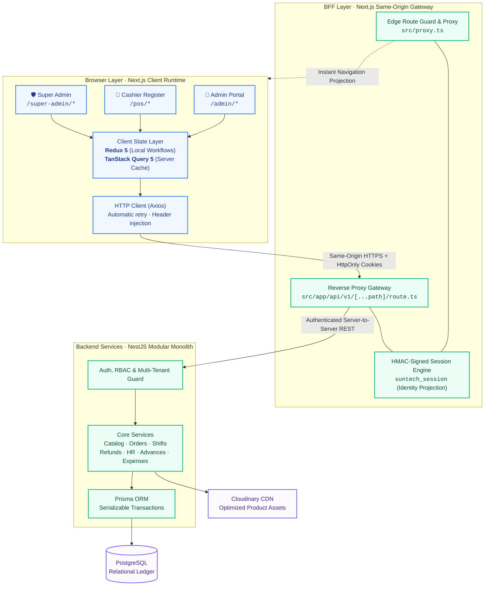
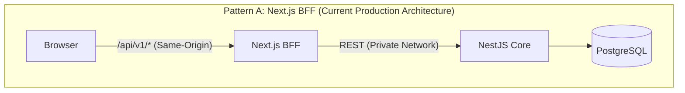
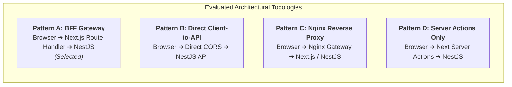
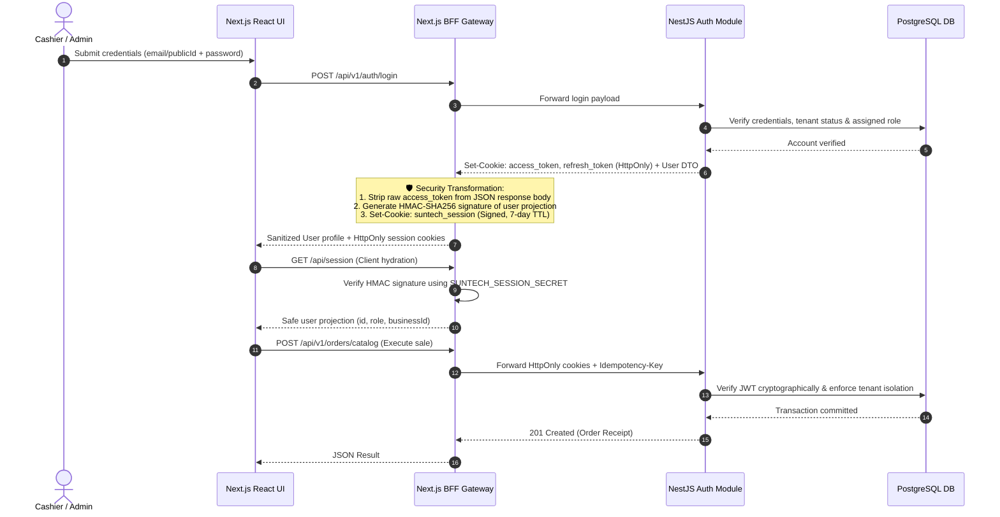
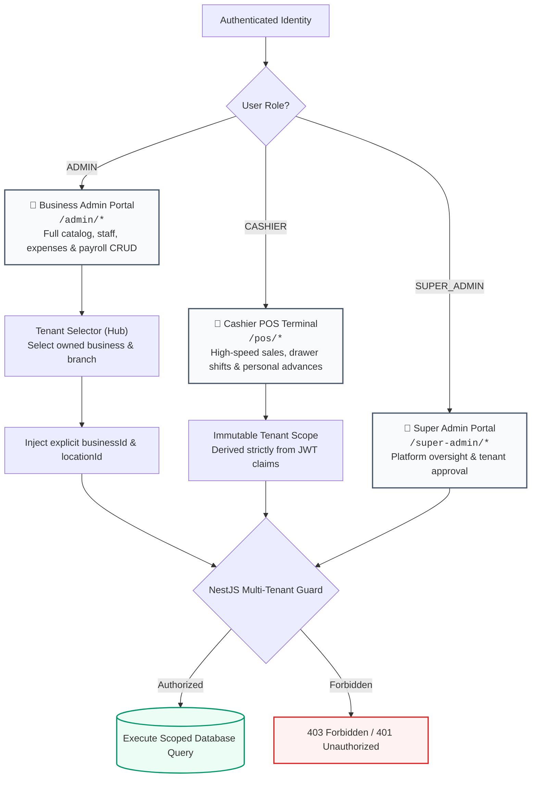
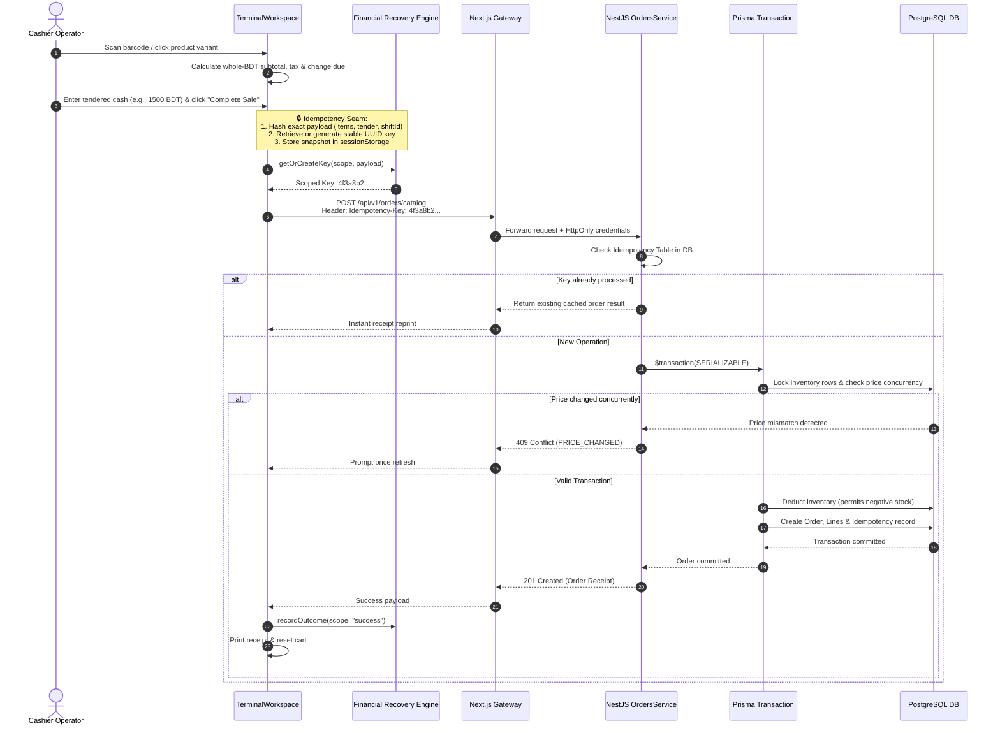
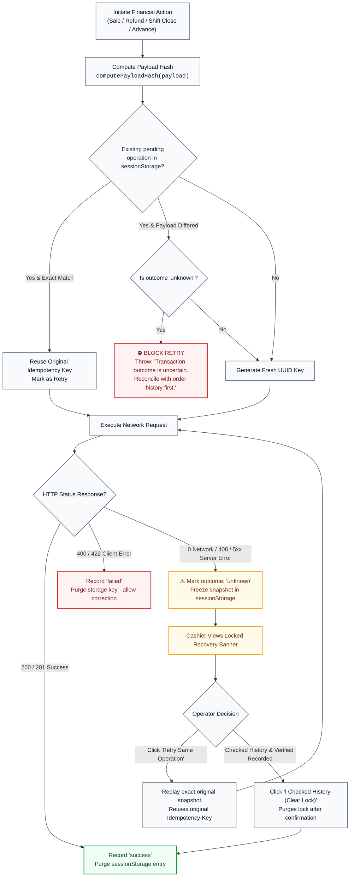

# ⚡ SunTech POS — Frontend Architecture & Technical Portfolio

[-black?style=for-the-badge&logo=next.js)](https://nextjs.org/)
[](https://react.dev/)
[](https://www.typescriptlang.org/)
[](https://tanstack.com/query)
[](https://redux.js.org/)
[](https://tailwindcss.com/)
[-6E9F18?style=for-the-badge&logo=vitest&logoColor=white)](https://vitest.dev/)

> **Executive Summary**: Production-grade, multi-tenant retail Point of Sale (POS) frontend engineered with **Next.js 16**, **React 19**, and a dedicated **Backend-for-Frontend (BFF)**. Built for high-velocity cashier operations, immutable financial idempotency recovery, role-segregated navigation, dual-cookie zero-trust authentication, and strict multi-location data isolation.

---

## 📌 Table of Contents

1. [System Architecture at a Glance](#1-system-architecture-at-a-glance)
2. [Why BFF? Architectural Alternatives & Tradeoff Analysis](#2-why-bff-architectural-alternatives--tradeoff-analysis)
3. [Dual-Cookie Security: NestJS JWT vs. Next.js HMAC Session](#3-dual-cookie-security-nestjs-jwt-vs-nextjs-hmac-session)
4. [Role Boundaries & Multi-Tenant Isolation](#4-role-boundaries--multi-tenant-isolation)
5. [Feature-Sliced Codebase Architecture](#5-feature-sliced-codebase-architecture)
6. [State Management, Caching & Race Condition Mitigation](#6-state-management-caching--race-condition-mitigation)
7. [The Anatomy of a Sale: Click to Database Transaction](#7-the-anatomy-of-a-sale-click-to-database-transaction)
8. [Financial Request Recovery & Idempotency Engine](#8-financial-request-recovery--idempotency-engine)
9. [Feature & Screen Inventory](#9-feature--screen-inventory)
10. [Local Setup & Verification Guide](#10-local-setup--verification-guide)
11. [Architectural Tradeoffs & Known Constraints](#11-architectural-tradeoffs--known-constraints)
12. [Staff Engineer Interview Defense & 45-Second Pitch](#12-staff-engineer-interview-defense--45-second-pitch)

---

## 1. System Architecture at a Glance

SunTech POS operates on an **online-first, multi-tenant architecture**. The frontend application acts as both a rich single-page client (React 19) and a specialized Edge gateway (Next.js BFF), decoupling the client from direct backend monolith communication.



### Core Technology Decisions

| Architectural Concern | Implementation Choice | Production Engineering Rationale |
| :--- | :--- | :--- |
| **Frontend Framework** | **Next.js 16 (App Router) + React 19** | Zero-bundle server utilities, instant routing, strict server/client boundary, and Turbopack dev builds. |
| **Modular Organization** | **Feature-Based (`src/features/*`)** | Strict domain co-location: hooks, components, view-models, and DTO validations live within domain boundaries. |
| **HTTP Gateway (BFF)** | **Next.js Route Handler (`/api/v1/[...path]`)** | Eliminates CORS overhead, keeps backend origins private, centralizes cookie forwarding, and strips token leakage. |
| **HTTP Transport** | **Axios Client (`src/lib/api-client.ts`)** | Deterministic error normalization (`ApiClientError`), bounded 401 token refresh loops, and request timeout governance. |
| **Server State** | **TanStack Query 5** | Stale-while-revalidate caching, automatic deduplication, fine-grained cache invalidation, and background synchronization. |
| **Client State** | **Redux 5 (`legacy_createStore`)** | Synchronous, predictable state transitions for shopping cart draft lines, payment calculations, and tenant context. |
| **Authorization Authority** | **NestJS JWT + Database Verification** | Backend remains the single source of truth for role, tenant ownership, and permission validation. |
| **Fast Navigation Projection** | **HMAC-SHA256 Signed Cookie (`suntech_session`)** | Edge proxy evaluates user role for route redirects without hitting the database on every navigation event. |
| **Money Representation** | **Integer Taka (BDT)** | Prevents floating-point rounding errors across all discount, VAT, line-item, and cash tender calculations. |
| **Financial Reliability** | **Session-Backed Idempotency Engine** | Preserves exact payload hashes and unique UUID idempotency keys across page reloads during network timeouts. |

---

## 2. Why BFF? Architectural Alternatives & Tradeoff Analysis

The **Backend-for-Frontend (BFF)** architecture was chosen deliberately over direct browser-to-backend communication. The decision balances operational complexity against enterprise security and developer experience:



### Exhaustive Architectural Comparison



| Decision Metric | Pattern A: Next.js BFF *(SunTech)* | Pattern B: Direct Client-to-API | Pattern C: Nginx / API Gateway | Pattern D: Next.js Server Actions |
| :--- | :---: | :---: | :---: | :---: |
| **Same-Origin Browser Context** | ✅ **Yes** | ❌ Requires CORS | ✅ **Yes** | ✅ **Yes** |
| **Token Leakage Prevention** | ✅ Access tokens stripped by BFF | ⚠️ Tokens exposed to browser JS | ⚠️ Handled at proxy level | ✅ Kept on server |
| **HMAC Session Route Guarding** | ✅ Built directly into Next runtime | ❌ Requires external session store | ❌ Requires Lua/OpenResty scripts | ⚠️ Clunky for high-frequency POS |
| **Network Hop Overhead** | ⚠️ +1 hop (~1-3ms internal network) | ✅ Direct connection | ⚠️ +1 proxy hop | ⚠️ +1 hop |
| **Request Forwarding Control** | ✅ Full streaming & multipart upload | ❌ Browser handles boundaries | ✅ Native C proxy speed | ❌ Multipart buffering limits |
| **Engineering Complexity** | **Moderate** (Pure TypeScript) | **Low** (Initial setup only) | **High** (Multi-container orchestration) | **High** (Complex POS cart mutations) |

> [!NOTE]
> **Verdict**: For SunTech POS (~100 active retail terminals per business), the **BFF pattern delivers optimal enterprise security**. It eliminates cross-origin token storage, centralizes request timeouts, protects backend network topology, and enables seamless HMAC session verification without adding external gateway dependencies.

---

## 3. Dual-Cookie Security: NestJS JWT vs. Next.js HMAC Session

SunTech POS implements a **dual-cookie, zero-trust security perimeter**:



### Cryptographic Distinction: JWT vs. HMAC Session

```
  ┌────────────────────────────────────────────────────────────────────────┐
  │                    HMAC SESSION COOKIE ARCHITECTURE                    │
  │                                                                        │
  │  Base64Url( { id, role, issuedAt } ) . Base64Url( HMAC-SHA256( ... ) ) │
  │  └──────────────────┬──────────────┘   └──────────────────┬──────────┘ │
  │                     │                                     │            │
  │              Visible Payload                      Cryptographic Seal   │
  │            (Tamper-Detectable)                  (Server Secret Only)   │
  └────────────────────────────────────────────────────────────────────────┘
```

| Security Property | NestJS Access Token (`access_token`) | Next.js Session Projection (`suntech_session`) |
| :--- | :--- | :--- |
| **Primary Responsibility** | Authenticates database transactions and business actions | Drives client-side routing, sidebar visibility, and redirects |
| **Issuer** | NestJS Core Authentication Service | Next.js BFF Route Handler on successful login |
| **Cryptographic Mechanism** | RS256 / HS256 JWT Signature with Expiration | HMAC-SHA256 Signature verified with constant-time equality |
| **Storage Mechanism** | `HttpOnly`, `SameSite=Lax`, `Secure` Cookie | `HttpOnly`, `SameSite=Lax`, `Secure` Cookie |
| **JavaScript Accessibility** | ❌ Completely inaccessible to browser scripts | ❌ Completely inaccessible to browser scripts |
| **Authority Level** | **Authoritative**: Validated against live DB permissions | **Informational**: Fast route projection; non-authoritative |

> [!IMPORTANT]
> **Zero-Trust Principle**: The client route guard ([`src/proxy.ts`](file:///D:/Project/SuntechPos-frontend/suntech-pos-frontend/src/proxy.ts)) checks the `suntech_session` HMAC to reject unauthorized navigation instantly. However, **the NestJS backend never trusts the frontend projection**; every financial API call cryptographically validates the JWT against PostgreSQL tenant ownership.

---

## 4. Role Boundaries & Multi-Tenant Isolation

The platform enforces strict role-based access control (RBAC) across three distinct user tiers:



### Shared Component Architecture Without Privilege Leakage

To prevent code duplication while maintaining strict security boundaries, core operational workspaces are designed as reusable, role-aware components:

1. **Terminal Workspace** (`TerminalWorkspace`):
   - Rendered at `/admin/terminal` with `role="admin"`. Permits on-the-fly branch and business switching.
   - Rendered at `/pos/terminal` with `role="cashier"`. Tenant scope is strictly immutable and locked to the cashier's active drawer assignment.
2. **Orders & Refund Workspace** (`OrdersWorkspace`):
   - Shared between `/admin/orders` and `/pos/orders`. Cashiers are restricted to processing refunds within their active shift, whereas Admins can issue cross-shift refunds with mandatory audit logging.
3. **Branch Switching Cache Invalidation Guard**:
   - Switching an Admin branch triggers `registerGuard.hasActiveRegisterWork()` and `financialOperations.hasUncertainOperations()`.
   - If an uncertain transaction or held cart exists on the active register, **branch switching is blocked** until the operation is resolved or cleared, preventing cross-tenant draft contamination.

---

## 5. Feature-Sliced Codebase Architecture

The project adheres to a scalable, domain-driven directory structure:

```bash
suntech-pos-frontend/
├── src/
│   ├── app/                               # Next.js App Router (Routing & Gateways)
│   │   ├── (auth)/                        # Authentication routes (login, register, reset)
│   │   ├── (dashboard)/                   # Protected operational portals
│   │   │   ├── admin/                     # Business management (catalog, staff, payroll, reports)
│   │   │   ├── pos/                       # Cashier operations (terminal, custom-sale, shifts, orders)
│   │   │   └── super-admin/               # Global platform administration
│   │   ├── api/
│   │   │   ├── session/route.ts           # Signed HMAC session projection handler
│   │   │   └── v1/[...path]/route.ts      # Same-origin BFF reverse proxy gateway
│   │   ├── layout.tsx                     # Global providers, fonts & notifications
│   │   └── globals.css                    # Tailwind CSS tokens (Electric Blue #0052FF)
│   ├── features/                          # Co-located domain modules
│   │   ├── auth/                          # Login/registration queries, mutations & forms
│   │   ├── catalog/                       # Products, variants, categories & bulk price updates
│   │   ├── pos/                           # Cart engine, terminal workspace & custom orders
│   │   ├── shifts/                        # Shift drawers, opening floats, reconciliation & metrics
│   │   ├── hr/                            # Staff directories, salary advances & payroll calculations
│   │   ├── expenses/                      # Expense tracking, category ledgers & attachments
│   │   ├── reports/                       # Sales analytics, profit/loss & tax reporting
│   │   ├── audit/                         # Security event viewers & activity logs
│   │   └── tenant/                        # Business/branch selector hub & tenant preferences
│   ├── components/                        # Design system & shared UI primitives
│   │   ├── common/                        # Data tables, pagination, metric cards & empty states
│   │   ├── ui/                            # Radix UI primitives (dialogs, badges, inputs, buttons)
│   │   └── layout/                        # Sidebar, role-aware headers & branch switcher
│   ├── lib/                               # Core utilities & enterprise infrastructure
│   │   ├── api-client.ts                  # Axios instance with cookie transport & error handling
│   │   ├── session-cookie.ts              # Web Crypto HMAC-SHA256 signing and verification
│   │   ├── financial-operation.ts         # Scoped idempotency persistence & recovery engine
│   │   ├── idempotency.ts                 # UUID generator & request header builders
│   │   ├── get-query-client.ts            # TanStack Query defaults & stale-time policies
│   │   ├── register-guard.ts              # Register draft protection & lock validator
│   │   └── tenant-preferences.ts          # Safe localStorage tenant memory
│   ├── redux/                             # Client state management
│   │   ├── actions/                       # Cart, shift, tenant & auth actions
│   │   ├── reducers/                      # Pure state transformation slices
│   │   └── store.ts                       # Legacy createStore configuration
│   └── types/                             # Domain models, API contracts & DTOs
└── vitest.config.ts                       # Vitest unit & contract test suite configuration
```

---

## 6. State Management, Caching & Race Control

The application implements a strict **separation of concerns** between server cache, client workflows, and persistent recovery data:

```
  ┌────────────────────────────────────────────────────────────────────────┐
  │                        TIERED STATE TOPOLOGY                           │
  ├───────────────────────┬────────────────────────┬───────────────────────┤
  │     SERVER CACHE      │     CLIENT WORKFLOW    │    RECOVERY LEDGER    │
  │    (TanStack Query)   │        (Redux 5)       │    (SessionStorage)   │
  ├───────────────────────┼────────────────────────┼───────────────────────┤
  │ • Product Catalog     │ • Active Cart Lines    │ • Unreconciled Sales  │
  │ • Shift History       │ • Applied Discounts    │ • Pending Refunds     │
  │ • Cashier Advances    │ • Selected Branch      │ • Shift Close Retries │
  │ • Monthly Payroll     │ • Tender Calculations  │ • Stable Request Key  │
  └───────────────────────┴────────────────────────┴───────────────────────┘
```

### TanStack Query Caching & Revalidation Strategy

- **Default Cache Policy**: `staleTime: 3 minutes`, `gcTime: 20 minutes`, `refetchOnWindowFocus: false`, `refetchOnReconnect: true`.
- **Query Key Scoping**: Every query key is strictly namespaced by tenant:
  `["catalog", { businessId, locationId, search, page }]`
- **Race Condition Prevention on Scope Switch**:
  When an Administrator switches branches in the Hub, the application immediately cancels all in-flight queries via `queryClient.cancelQueries()` across 12 domains (`catalog`, `shifts`, `orders`, `payroll`, `reports`, etc.), preventing older branch data from overwriting newly requested branch state.

```mermaid
flowchart LR
  UI["User Interaction"] --> ACTION{"Action Type"}
  
  ACTION -->|Cart / Tender| R["Redux Store<br/>Instant UI feedback"]
  ACTION -->|Fetch Server Data| Q["TanStack Query Cache"]
  
  Q -->|Cache Hit (Fresh)| RENDER["Render View"]
  Q -->|Cache Miss / Stale| FETCH["Axios Client ➔ BFF"]
  FETCH -->|Response| UPDATE["Update Cache & Re-render"]
  
  ACTION -->|Tenant Switch| CANCEL["Cancel In-Flight Queries<br/><code>queryClient.cancelQueries()</code>"]
  CANCEL --> PURGE["Invalidate Domain Caches"]
  PURGE --> FETCH
```

---

## 7. The Anatomy of a Sale: Click to Database Transaction

Here is the deterministic lifecycle of a POS transaction:



### Exact Wire Contract Example (`POST /api/v1/orders/catalog`)

```http
POST /api/v1/orders/catalog HTTP/1.1
Host: localhost:3001
Content-Type: application/json
Idempotency-Key: a8f0c294-84d2-43bb-86e5-41e976c70311

{
  "businessId": "b164c0f7-7719-4958-9bff-05a267ce6fb7",
  "locationId": "loc-dhanmondi-01",
  "shiftId": "shift-morning-20261102",
  "paymentMethod": "COD",
  "tenderedAmount": 1500,
  "customerName": "Walk-in Customer",
  "lines": [
    {
      "variantId": "var-cotton-shirt-m",
      "quantity": 3,
      "unitPrice": 400
    }
  ]
}
```

---

## 8. Financial Request Recovery & Idempotency Engine

In brick-and-mortar retail environments, network disruptions, power outages, and gateway timeouts (`HTTP 0`, `408`, `5xx`) can leave the client in an uncertain state: **Did the transaction commit on the server or fail?**

A simple disabled button cannot solve this. SunTech POS features an in-tab **Durable Financial Operation Ledger** ([`src/lib/financial-operation.ts`](file:///D:/Project/SuntechPos-frontend/suntech-pos-frontend/src/lib/financial-operation.ts)):



### Supported Idempotent Financial Domains

1. **Catalog Sales** (`catalog_sale`)
2. **Custom Register Sales** (`custom_sale`)
3. **Refund Processing** (`refund`)
4. **Shift Drawer Opening** (`shift_open`)
5. **Shift Drawer Reconciliation** (`shift_close`)
6. **Cashier Salary Advances** (`advance_create`)
7. **Payroll Processing** (`payroll_process`)
8. **Payroll Disbursement** (`payroll_disburse`)

---

## 9. Feature & Screen Inventory

| Operational Domain | Web Route | User Role | Core Capabilities & API Integrations |
| :--- | :--- | :--- | :--- |
| **Authentication** | `/login`, `/register`, `/forgot-password` | Public | Public credential validation, rate limiting, and session initialization. |
| **Tenant Selection** | `/admin/select-business` | Admin | Multi-location switching, active branch memory, and draft protection. |
| **Analytics Dashboard**| `/admin/dashboard` | Admin | Real-time revenue telemetry, low-stock alerts, and daily sales trends. |
| **Catalog Management**| `/admin/catalog` | Admin | Variant-level SKU tracking, barcode generation, categories, and Cloudinary media upload. |
| **Cashier POS Register**| `/admin/terminal`, `/pos/terminal` | Admin / Cashier | Barcode scanning, whole-BDT tender calculation, held tickets, and receipt generation. |
| **Custom Sale Entry** | `/admin/custom-sale`, `/pos/custom-sale` | Admin / Cashier | Ad-hoc service or non-inventory billing with cash/MFS payment options. |
| **Orders & Refunds** | `/admin/orders`, `/pos/orders` | Admin / Cashier | Searchable transaction history, itemized returns, and shift-backed payouts. |
| **Cashier Drawer Shifts**| `/pos/shifts` | Cashier | Opening float verification, cash count reconciliation, and salary advance requests. |
| **Staff & Permissions**| `/admin/staff` | Admin | Cashier account provisioning, PIN generation, and role assignment. |
| **Payroll Management** | `/admin/payroll` | Admin | Advance deduction reconciliation, net pay calculation, and disbursement locks. |
| **Expense Ledger** | `/admin/expenses` | Admin | Operational cost logging, petty cash categorization, and receipt attachments. |
| **Financial Reports** | `/admin/reports` | Admin | Exportable profit/loss, daily sales summaries, and tax compliance sheets. |
| **System Audit Logs** | `/admin/audit-logs` | Admin | Immutable timeline of administrative actions, price overrides, and shift variances. |
| **Super Admin Portal** | `/super-admin` | Super Admin | Tenant approval, subscription management, and system-wide telemetry. |

---

## 10. Local Setup & Verification Guide

### Prerequisites

- **Node.js**: `v20.x` or higher (compatible with React 19 and Next.js 16)
- **Package Manager**: `npm`
- **Backend Service**: Running instance of `SuntechPOS-backend` on port `3000` with PostgreSQL.

### Installation & Execution

```bash
# 1. Install exact locked dependencies
npm ci

# 2. Configure local environment variables
cp .env.example .env.local
```

Edit `.env.local` with the following configuration:

```env
# Backend server origin ONLY (No trailing slash, no /api/v1 suffix)
BACKEND_API_URL=http://localhost:3000

# High-entropy secret for HMAC session signing (min 32 characters)
SUNTECH_SESSION_SECRET=c8f391a27e4b9d08e12f65a4c78103b2e59a1f48d02c67b93e41a58d20f67c3b

# Application Metadata
NEXT_PUBLIC_APP_NAME="SunTech POS"
NEXT_PUBLIC_ALLOW_DEV_PREVIEW=false
```

```bash
# 3. Start development server on port 3001 (avoids collision with backend port 3000)
npm run dev:frontend
```

### Full Quality Verification Suite

```bash
# Strict TypeScript semantic type check
npm run typecheck

# ESLint inspection (Next.js 16 + React 19 ruleset)
npm run lint

# Vitest complete unit & contract test suite
npm run test

# Next.js Turbopack production compilation
npm run build
```

---

## 11. Architectural Tradeoffs & Known Constraints

A senior engineer recognizes that every architectural pattern involves deliberate tradeoffs:

| Design Dimension | Current Implementation | Architectural Rationale & Tradeoff Analysis |
| :--- | :--- | :--- |
| **BFF Hop Latency** | Next.js API Route Handler acts as reverse proxy | Incurs an additional ~2ms internal network hop. In return, it completely eliminates CORS, hides backend IP topology, and securely manages HttpOnly cookies. |
| **Session Cache Staleness** | Client-side HMAC cookie holds user projection | The session cookie has a 7-day TTL. If an Admin revokes a Cashier's role in the DB, the client UI might show the route until cookie refresh; however, **the NestJS backend rejects all API calls immediately**. |
| **Offline Mode (PWA)** | Deferred for Phase 2 | Full offline-first transactional queuing requires local IndexedDB synchronization and complex conflict resolution. The MVP prioritizes bulletproof online transactional consistency. |
| **Redux Architecture** | Redux 5 with `legacy_createStore` | Avoided unnecessary Redux Toolkit boilerplate for straightforward cart and drawer state. Transition to Redux Toolkit or Zustand is straightforward if complex client slices emerge. |
| **Currency Representation** | Integer Taka (No decimal paisa) | Modern Bangladeshi retail transactions rarely use fractional paisa. Storing integer BDT guarantees zero IEEE-754 floating-point arithmetic errors across checkout computations. |

---

## 12. Staff Engineer Interview Defense & 45-Second Pitch

### Top 6 Technical Interview Questions & Model Answers

<details>
<summary><b>Q1: Why implement a Next.js BFF instead of having the browser call NestJS directly?</b></summary>
<br/>

> *"Having the browser call the backend directly introduces CORS complexities, requires exposing API origins to client JavaScript, and complicates HttpOnly cookie forwarding across differing subdomains. Our Next.js BFF provides a clean same-origin interface (`/api/v1/*`), strips access tokens from JSON bodies before they reach the browser, and handles HMAC session projection. While it introduces a negligible ~2ms network hop, the security, cookie isolation, and unified domain benefits far outweigh the overhead for our retail scale."*
</details>

<details>
<summary><b>Q2: What is the difference between your JWT and HMAC session cookies? Why two?</b></summary>
<br/>

> *"They serve two completely different security boundaries. The **NestJS JWT** is an authoritative, cryptographically signed access token verified against our PostgreSQL database for every sensitive mutation. The **Next.js HMAC session** (`suntech_session`) is a lightweight client identity projection signed with a server-only secret. It allows our Next.js edge proxy to perform instant, tamper-proof route redirection (preventing Cashiers from visiting `/admin/*`) without incurring a round-trip database query on every single page navigation."*
</details>

<details>
<summary><b>Q3: How does SunTech POS prevent duplicate transactions during network timeouts?</b></summary>
<br/>

> *"We implement a client-coordinated idempotency engine. Before sending `POST /orders/catalog`, we compute a deterministic hash of the exact payload lines and bind it to a stable UUID in `sessionStorage`. If the request times out or returns an HTTP 504, the outcome is marked as 'unknown'. The cashier's register locks, and the retry button automatically replays the exact stored snapshot with the original `Idempotency-Key`. The backend database detects the key and returns the original committed order without re-deducting stock or charging twice."*
</details>

<details>
<summary><b>Q4: What happens to active state when an Admin switches branch locations?</b></summary>
<br/>

> *"Tenant switching is guarded against race conditions and draft leakage. First, `registerGuard` verifies that the active register has no unreconciled transactions or pending items; if it does, the switch is blocked. Once confirmed, `chooseScope` updates Redux and localStorage, and immediately invokes `queryClient.cancelQueries()` across 12 domain caches (catalog, shifts, payroll, orders). This terminates in-flight requests and clears the cache, guaranteeing that data from Branch A never flashes on Branch B."*
</details>

<details>
<summary><b>Q5: Why aren't you using Microservices or Redis for this architecture?</b></summary>
<br/>

> *"For an initial target of ~100 active retail terminals per business, distributed microservices and Redis introduce needless operational complexity, eventual consistency bugs, network partition failures, and DevOps overhead. A well-structured Next.js BFF paired with a modular NestJS monolith and PostgreSQL serializable transactions easily handles thousands of requests per minute at single-digit millisecond latency with rock-solid ACID guarantees."*
</details>

<details>
<summary><b>Q6: How are floating-point monetary rounding errors handled?</b></summary>
<br/>

> *"By eliminating floating-point math entirely. All prices, opening floats, discounts, tenders, and advances are stored and calculated as integer Bangladesh Taka (BDT). Line item arithmetic follows strict safe integer constraints (`Number.isSafeInteger`), and formatting utilities only append the currency symbol (`৳`) at the final presentation layer."*
</details>

---

### 🎙️ The 45-Second Technical Elevator Pitch

> *"I engineered the SunTech POS frontend using **Next.js 16**, **React 19**, and **TypeScript** with a feature-sliced architecture. Client data fetching is managed via **TanStack Query** with strict tenant-scoped caching, while **Redux** orchestrates local register workflows. All browser requests pass through a same-origin **Next.js BFF gateway**, which strips sensitive tokens and maintains an HMAC-signed session projection for instant route guarding. The NestJS backend remains the strict authority for database authorization and multi-tenant isolation. To ensure bulletproof financial reliability during network drops, we implemented a tab-local idempotency recovery engine that preserves exact request snapshots and UUID keys, preventing duplicate charges across intermittent retail connectivity."*

---

<div align="center">

**Built with precision for modern, resilient retail commerce.**<br/>
<sub>Engineered with Next.js 16, React 19, TypeScript & Tailwind CSS.</sub>

</div>
