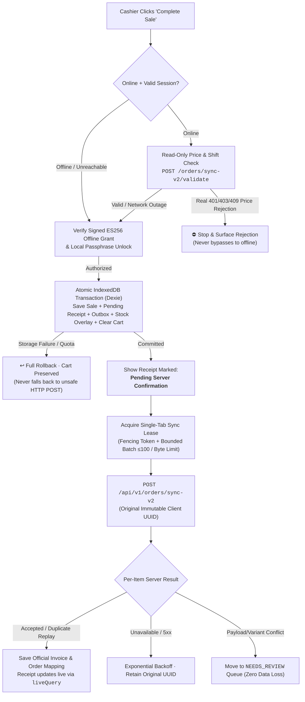
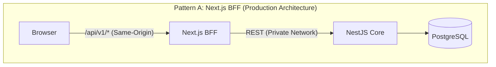
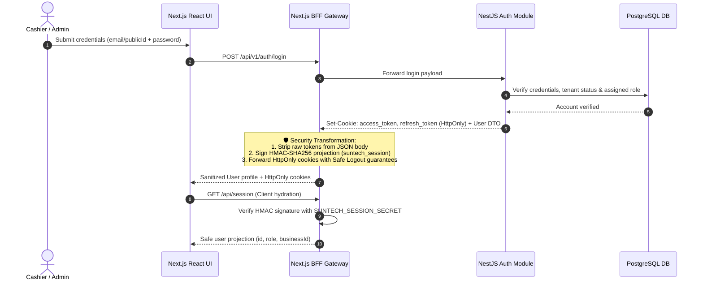
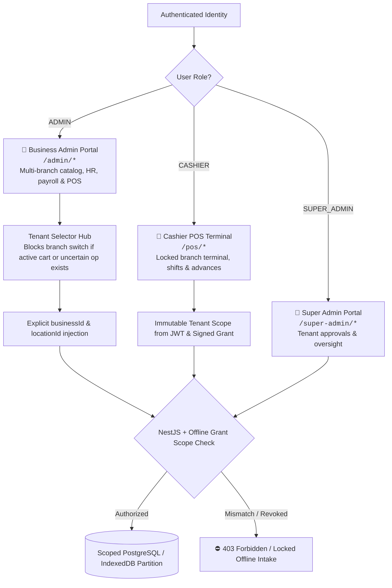
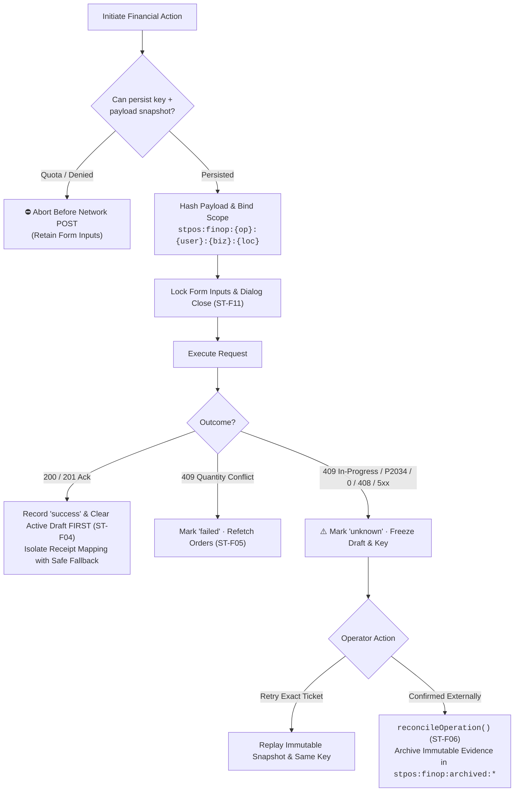

# ⚡ SunTech POS — Offline-First Retail POS Architecture & UI Portfolio

[-000000?style=for-the-badge&logo=next.js)](https://nextjs.org/)
[](https://react.dev/)
[](https://www.typescriptlang.org/)
[-0052FF?style=for-the-badge)](https://dexie.org/)
[](https://tanstack.com/query)
[](https://redux.js.org/)
[](https://tailwindcss.com/)
[-6E9F18?style=for-the-badge&logo=vitest&logoColor=white)](https://vitest.dev/)
[](https://playwright.dev/)

> **Executive Summary**: Production-grade, **offline-first, multi-tenant retail Point of Sale (POS)** frontend engineered with **Next.js 16**, **React 19**, **Dexie (IndexedDB)**, and a zero-trust **Backend-for-Frontend (BFF)**. Built for high-velocity retail cashiers, strict integer-BDT financial integrity, cryptographically signed offline selling grants, and a crisp Electric Blue (`#0052FF`) interface.

---

## 🎯 Snapshot for Hiring Managers & Engineering Leads

If you are reviewing this repository for **Frontend / Full-Stack Architecture** or **Product UI Engineering**, here are the core engineering pillars demonstrated in production code:

| Pillar | What Was Engineered | Key Files |
| :--- | :--- | :--- |
| **Product UI & Motion Craft** | Electric-blue design system (`#0052FF`), responsive split-pane POS register, permanently enabled Framer Motion choreography, interactive Demo Modal, and bundled Bengali/Latin thermal PDF receipts. | [`src/components/landing/`](src/components/landing/), [`src/features/pos/components/terminal-workspace.tsx`](src/features/pos/components/terminal-workspace.tsx) |
| **Offline-First POS & PWA** | Zero-passphrase trusted-device offline checkout (`Dexie`), custom neutral-shell Service Worker (`suntech-sw.js`), single-tab fenced upload leases, ES256 signed offline permissions (30-day grant window), and encrypted backup/restore in Help. | [`src/features/offline/`](src/features/offline/), [`scripts/build-offline.mjs`](scripts/build-offline.mjs) |
| **Financial Safety & Recovery** | 9-domain idempotency engine (`financialOperations`), archived manual reconciliation (`ST-F06`), isolated receipt rendering (`ST-F04`), 409 conflict classification (`ST-F05`), and in-flight form locking (`ST-F11`). | [`src/lib/financial-operation.ts`](src/lib/financial-operation.ts), [`src/features/pos/components/orders-workspace.tsx`](src/features/pos/components/orders-workspace.tsx) |
| **Zero-Trust BFF Security** | Same-origin Next.js reverse proxy (`/api/v1/[...path]`) stripping tokens from JSON responses, dual `HttpOnly` JWT + HMAC-SHA256 session projection (with 30-day offline grace renewal), and safe outage-aware sign-out. | [`src/app/api/v1/[...path]/route.ts`](src/app/api/v1/%5B...path%5D/route.ts), [`src/lib/session-cookie.ts`](src/lib/session-cookie.ts) |
| **Verification Depth** | **54 Vitest files (396 tests)**, **26 recovery tests**, **44 advanced command tests**, **8 Playwright Chromium E2E tests**, and **20 full-stack NestJS + PostgreSQL HTTP tests**. | [`src/lib/__tests__/`](src/lib/__tests__/), [`scripts/`](scripts/), [`e2e/`](e2e/) |

---

## 📌 Table of Contents

1. [UI / UX & Product Design Showcase](#-ui--ux--product-design-showcase)
2. [System Architecture at a Glance](#1-system-architecture-at-a-glance)
3. [Offline-First Checkout, Sync & PWA Architecture](#2-offline-first-checkout-sync--pwa-architecture)
4. [Why BFF? Architectural Alternatives & Tradeoff Analysis](#3-why-bff-architectural-alternatives--tradeoff-analysis)
5. [Dual-Cookie Security: NestJS JWT vs. Next.js HMAC Session](#4-dual-cookie-security-nestjs-jwt-vs-nextjs-hmac-session)
6. [Role Boundaries & Multi-Tenant Isolation](#5-role-boundaries--multi-tenant-isolation)
7. [Feature-Sliced Codebase Architecture](#6-feature-sliced-codebase-architecture)
8. [State Management, Caching & Race Control](#7-state-management-caching--race-control)
9. [Financial Request Recovery & Idempotency Engine](#8-financial-request-recovery--idempotency-engine)
10. [Feature & Screen Inventory](#9-feature--screen-inventory)
11. [Local Setup & Verification Guide](#10-local-setup--verification-guide)
12. [Architectural Tradeoffs & Known Constraints](#11-architectural-tradeoffs--known-constraints)
13. [Senior / Staff Engineer Interview Defense & 45-Second Pitch](#12-senior--staff-engineer-interview-defense--45-second-pitch)

---

## 🎨 UI / UX & Product Design Showcase

SunTech POS pairs **enterprise transactional rigor** with a **calm, high-speed retail interface** tailored for real-world shop counters (desktop, tablet, and low-connectivity environments):

### 1. Design System & Visual Tokens
- **Brand Palette**: Crisp Slate canvas (`#F8FAFC`), high-legibility Ink (`#070B28`), and signature Electric Blue (`#0052FF`) interactive accents ([`src/app/globals.css`](src/app/globals.css)).
- **Offline-Bundled Bilingual Typography**: Uses **Poppins** (UI & tabular financial numerals) paired with **Noto Sans Bengali** bundled locally into `public/fonts/` so thermal receipts, customer names, and product labels render accurately even with zero internet access.
- **Performance & Accessibility**: Offscreen list virtualization via `.cv-auto` (`content-visibility: auto`), Radix UI accessible primitives, keyboard-navigable controls, and `useReducedMotionPreference` guarding every Framer Motion transition.

### 2. Interactive Product Landing Experience ([`src/app/page.tsx`](src/app/page.tsx))
- **Motion-Choreographed Showcase**: Dedicated landing modules ([`HeroSection`](src/components/landing/hero-section.tsx), [`TelemetryStrip`](src/components/landing/telemetry-strip.tsx), [`CheckoutShowcase`](src/components/landing/checkout-showcase.tsx), [`FeatureShowcase`](src/components/landing/feature-showcase.tsx), [`CapabilityCards`](src/components/landing/capability-cards.tsx), and [`OperationsPreview`](src/components/landing/operations-preview.tsx)) paired with silent backend warmup (`BackendWarmup`) and an animated `DemoLoginModal`.

### 3. Cashier & Admin Workspace Ergonomics
- **High-Velocity Split-Pane Register ([`TerminalWorkspace`](src/features/pos/components/terminal-workspace.tsx))**:
  - Instant barcode & SKU search, variant pills inside product cards, and a **5-slot Held Drafts** tab to park/resume active customer tickets without losing queue state.
  - **Smart Collapsible Customer Bar** (defaults to `Walk-in Customer` with 1-click expand) and **1-row 4-pill payment selector** (`COD`, `BKASH`, `NAGAD`, `BANK`).
  - **Zero-Flicker In-Flight Locking**: Customer fields, quantities, draft switching, and refund modals lock deterministically during active mutations (`isSubmitting` / `mutationsLocked`) so fast double-taps cannot corrupt submitted totals.
- **Resilient Receipts & Offline Status UI**:
  - [`ReceiptDialog`](src/features/pos/components/receipt-dialog.tsx) supports `P` / `Ctrl+P` hotkeys, 80mm thermal CSS printing, plain-text downloads, Bengali-safe PDF print previews, and live `Dexie` reactivity (`liveQuery`) that automatically flips a receipt from **`Pending Server Confirmation`** to its official server invoice number once synced.
  - [`OfflineStatus`](src/features/offline/ui/offline-status.tsx) renders a minimal navbar status pill (`Online`, `Offline`, `Syncing`, `Offline · N pending`, `Needs attention`) while moving scoped diagnostics, encrypted `.json` device backup/restore, and queue review into the Admin/Cashier Help pages so daily POS screens remain uncluttered.
  - **Automatic Trusted-Device Restoration**: After verified online sign-in (and branch selection for Admin), offline selling activates automatically without a separate offline passphrase or login prompt, while explicit Sign Out, account switches, or confirmed server `401`/`403` rejections immediately lock offline restoration without erasing queued receipts.

---

## 1. System Architecture at a Glance

SunTech POS operates on a **local-first checkout + zero-trust BFF multi-tenant architecture**. Catalog and custom sales commit atomically in the browser's IndexedDB before syncing over the same-origin Next.js BFF gateway to the NestJS + PostgreSQL core.

```mermaid
flowchart TB
  subgraph UI["Browser Runtime · Next.js 16 + React 19 Client"]
    A["👑 Admin Portal<br/><code>/admin/*</code>"]
    C["🛒 Cashier Register<br/><code>/pos/*</code>"]
    S["🛡️ Super Admin<br/><code>/super-admin/*</code>"]
    State["Client State<br/><b>Redux 5</b> (Register Drafts)<br/><b>TanStack Query 5</b> (Server Cache)"]
    Offline["Local-First Engine (Dexie / IndexedDB)<br/>Signed ES256 Grants · Atomic Outbox · Sync Lease"]
    SW["PWA Service Worker (<code>suntech-sw.js</code>)<br/>Neutral Offline Shell & Static Assets Only"]
    API["Axios HTTP Client<br/>Normalized Errors · Bounded Refresh"]

    A & C & S --> State
    C & A --> Offline
    Offline --> API
    State --> API
    SW -.-> UI
  end

  subgraph NEXT["BFF Layer · Next.js Same-Origin Gateway"]
    GW["Reverse Proxy Gateway<br/><code>src/app/api/v1/[...path]/route.ts</code>"]
    ROUTE["Edge Route Guard & Proxy<br/><code>src/proxy.ts</code>"]
    SESSION["HMAC-SHA256 Session Projection<br/><code>suntech_session</code>"]

    ROUTE --- SESSION
    GW --- SESSION
  end

  subgraph BACK["Backend Services · NestJS Modular Monolith"]
    AUTH["Auth, RBAC, Offline Grant & Multi-Tenant Guard"]
    DOM["Core & Offline Services<br/>Catalog · Orders · Sync V2 · Refunds · HR · Expenses"]
    ORM["Prisma ORM<br/>Serializable ACID Transactions & Identity Ledger"]

    AUTH --> DOM --> ORM
  end

  DB[("PostgreSQL<br/>Relational Ledger")]
  MEDIA["Cloudinary CDN<br/>Product Media"]

  API -->|"Same-Origin HTTPS + HttpOnly Cookies"| GW
  GW -->|"Authenticated Server-to-Server REST"| AUTH
  ORM --> DB
  DOM --> MEDIA

  classDef browser fill:#eff6ff,stroke:#3b82f6,color:#1e3a8a,stroke-width:2px;
  classDef server fill:#ecfdf5,stroke:#10b981,color:#064e3b,stroke-width:2px;
  classDef db fill:#fbfbfe,stroke:#8b5cf6,color:#4c1d95,stroke-width:2px;
  class A,C,S,State,Offline,SW,API browser;
  class GW,ROUTE,SESSION,AUTH,DOM,ORM server;
  class DB,MEDIA db;
```

### Core Technology Decisions

| Architectural Concern | Implementation Choice | Production Engineering Rationale |
| :--- | :--- | :--- |
| **Frontend Framework** | **Next.js 16.4.6 (App Router) + React 19.3** | Turbopack compilation, zero-bundle server routes, strict client/server boundaries, and patched security baseline. |
| **Offline Persistence** | **Dexie 4.4 (`IndexedDB`)** | Stores scoped catalog snapshots, pending sales, official server receipts, local stock overlays, outbox batches, and sync leases atomically. |
| **Offline Authorization** | **Signed ES256 Grants + Passphrase Unlock** | Separates *selling authority* from *register recovery*; encrypted local unlock uses PBKDF2/WebCrypto without weakening live server RBAC. |
| **PWA Caching Strategy** | **Custom Build (`scripts/build-offline.mjs`)** | Generates `suntech-sw.js` with a neutral startup shell (`public/offline-assets/`) so private RSC/API payloads never leak into shared cache. |
| **HTTP Gateway (BFF)** | **Next.js Route Handler (`/api/v1/[...path]`)** | Eliminates CORS, hides private backend topology, forwards `HttpOnly` cookies, and strips raw tokens from JSON payloads. |
| **HTTP Transport** | **Axios Client (`src/lib/api-client.ts`)** | Deterministic error normalization (`ApiClientError`), bounded single-flight 401 token refresh, and explicit network-vs-denial classification. |
| **Server & Client State** | **TanStack Query 5 + Redux 5** | Domain-scoped server cache with multi-domain query cancellation on branch switch + synchronous Redux draft/cart state. |
| **Money Representation** | **Integer Taka (BDT)** | Strict safe-integer bounds (`Number.isSafeInteger`) eliminate IEEE-754 rounding drift across prices, tenders, and refunds. |

---

## 2. Offline-First Checkout, Sync & PWA Architecture

Every new **Catalog Sale** and **Custom Sale** flows through a unified local-first writer (`src/features/offline/services/checkout.ts` + `core/checkout.ts`) backed by `Dexie` (`src/features/offline/db/offline-db.ts`):



### Offline Capabilities & Guardrails
- **Uncapped Local Queue (`1,257+` Verified Scale)**: Preserves the existing **5-held-ticket limit** for open drafts while placing **zero artificial cap** on completed offline sales. Sync uploads drain in bounded batches (max 100 events / payload byte limits with adaptive HTTP 413 splitting).
- **Dual-Protocol Safety (`LOCAL_FIRST_V2` vs `LEGACY_HTTP`)**: New local-first transactions use `LOCAL_FIRST_V2`. Existing/in-flight HTTP operations (`LEGACY_HTTP`) retain their original keys and reconcile against `GET /orders/legacy-status/:key` without ever creating duplicate charges across protocols.
- **Encrypted Backup & Recovery (`v1` & `v2`)**: [`src/features/offline/core/backup.ts`](src/features/offline/core/backup.ts) exports encrypted device recovery bundles so operators can recover pending receipts, sales, and reconciled evidence across browser issues without forging server confirmations.
- **Honest Offline Scope**: Only prepared Catalog Sales, Custom Sales (and flag-gated Phase 8–10 offline refund-payout evidence / product description CAS edits when enabled) run offline. Staff, Payroll, Advances, Expenses, Reports, Shifts Open/Close, and Catalog creation remain explicitly online.

---

## 3. Why BFF? Architectural Alternatives & Tradeoff Analysis

The **Backend-for-Frontend (BFF)** architecture was chosen deliberately over direct browser-to-backend communication:



| Decision Metric | Pattern A: Next.js BFF *(SunTech)* | Pattern B: Direct Client-to-API | Pattern C: Nginx / API Gateway | Pattern D: Next.js Server Actions |
| :--- | :---: | :---: | :---: | :---: |
| **Same-Origin Browser Context** | ✅ **Yes** | ❌ Requires CORS | ✅ **Yes** | ✅ **Yes** |
| **Token Leakage Prevention** | ✅ Access tokens stripped by BFF | ⚠️ Tokens exposed to JS | ⚠️ Proxy-level only | ✅ Kept on server |
| **HMAC Session Route Guarding** | ✅ Built into Next runtime | ❌ External store needed | ❌ OpenResty/Lua required | ⚠️ Awkward for POS streams |
| **Network Hop Overhead** | ⚠️ +1 hop (~1–3ms internal) | ✅ Direct | ⚠️ +1 proxy hop | ⚠️ +1 hop |
| **Streaming & Multipart Uploads** | ✅ Full BFF control | ❌ Browser boundaries | ✅ Native C proxy | ❌ Form buffering limits |

---

## 4. Dual-Cookie Security: NestJS JWT vs. Next.js HMAC Session

SunTech POS enforces a **dual-cookie, zero-trust perimeter**:



| Security Property | NestJS Access Token (`access_token`) | Next.js Session Projection (`suntech_session`) |
| :--- | :--- | :--- |
| **Primary Responsibility** | Authenticates financial writes, offline grant provisioning, and DB queries | Drives fast edge routing, sidebar visibility, and portal redirects |
| **Cryptographic Mechanism** | Signed JWT validated by NestJS guards | HMAC-SHA256 verified with constant-time equality (`timingSafeEqual`) |
| **Storage & JS Access** | `HttpOnly`, `SameSite=Lax`, `Secure` (No JS access) | `HttpOnly`, `SameSite=Lax`, `Secure` (No JS access) |
| **Authority Level** | **Authoritative** (DB-checked) | **Informational** (Fast projection; never trusted by backend) |

---

## 5. Role Boundaries & Multi-Tenant Isolation



---

## 6. Feature-Sliced Codebase Architecture

```bash
suntech-pos-frontend/
├── src/
│   ├── app/                               # Next.js App Router (25 App Routes + BFF)
│   │   ├── (auth)/                        # Login (online + prepared offline entry), Register, Reset
│   │   ├── (dashboard)/                   # Protected portals (/admin/*, /pos/*, /super-admin/*)
│   │   ├── api/
│   │   │   ├── session/route.ts           # HMAC-SHA256 session projection & safe logout cookies
│   │   │   ├── warmup/route.ts            # Silent backend warmup route
│   │   │   └── v1/[...path]/route.ts      # Same-origin BFF reverse proxy gateway
│   │   ├── page.tsx                       # Motion-choreographed SaaS landing showcase
│   │   └── globals.css                    # Tailwind CSS v4 tokens (#0052FF Electric Blue)
│   ├── features/                          # Domain-co-located feature modules
│   │   ├── offline/                       # Local-first IndexedDB, sync, grants, backup & PWA UI
│   │   │   ├── core/                      # Bootstrap, cart, checkout, ES256 grants, sync & backup
│   │   │   ├── db/                        # Dexie v3 schema (`offline-db.ts`, `category-cache.ts`)
│   │   │   ├── pwa/                       # Service worker registration, offline entry & asset helpers
│   │   │   ├── services/                  # Offline adapters (checkout, catalog, shifts, recovery)
│   │   │   └── ui/                        # `OfflineProvider`, `OfflineStatus`, `OfflineAccess`, recovery UI
│   │   ├── pos/                           # Register workspace, custom sale, refunds, receipts & hooks
│   │   │   ├── hooks/                     # `useDurableRegister`, `useDurableCustomSale`
│   │   │   └── utils/                     # Thermal PDF/print, durable sessions, receipt fallbacks
│   │   ├── auth/, catalog/, expenses/     # Auth flows, inventory SKU/variants, expense ledger
│   │   ├── hr/, shifts/, reports/         # Payroll, advances, shift drawers, Dhaka-time reports
│   │   └── audit/, tenant/, help/         # Immutable audit logs, multi-branch hub, animated help
│   ├── components/
│   │   ├── landing/ & motion/             # Landing showcase cards, checkout demo & motion primitives
│   │   ├── common/ & layout/              # Data tables, metrics, navbar profile, branch switcher
│   │   └── ui/                            # Radix UI accessible primitives
│   ├── lib/                               # Financial recovery, BFF client, validations & guards
│   │   ├── financial-operation.ts         # 9-domain scoped idempotency + durable archive (`reconcileOperation`)
│   │   ├── register-transition.ts         # Safe scope transitions & draft/lock fencing
│   │   ├── api-client.ts                  # Axios transport + bounded 401 refresh recovery
│   │   └── validations/                   # Zod schemas + whole-BDT safe integer money bounds
│   └── redux/                             # Synchronous client draft, cart, shift & tenant slices
├── public/
│   ├── fonts/                             # Offline-bundled Poppins & Noto Sans Bengali (.woff2 + licenses)
│   ├── icons/ & manifest.json             # PWA icons (192x192, 512x512) & installable manifest
├── scripts/                               # `build-offline.mjs`, `service-worker.template.js`, regression runners
├── e2e/                                   # Playwright offline browser specs & local test server
├── docs/offline/                          # Master SDD, API matrix, Phase 0–12 verification reports
└── vitest.config.ts                       # Vitest unit & contract configuration
```

---

## 7. State Management, Caching & Race Control

```
  ┌───────────────────────────────────────────────────────────────────────────────┐
  │                         FOUR-TIER CLIENT STATE TOPOLOGY                       │
  ├──────────────────┬──────────────────┬────────────────────┬────────────────────┤
  │   SERVER CACHE   │  CLIENT WORKFLOW │  LEGACY RECOVERY   │  DURABLE OFFLINE   │
  │ (TanStack Query) │     (Redux 5)    │  (SessionStorage)  │ (Dexie IndexedDB)  │
  ├──────────────────┼──────────────────┼────────────────────┼────────────────────┤
  │ • Live Catalog   │ • Held Drafts (5)│ • In-Flight Keys   │ • Scoped Snapshots │
  │ • Server Orders  │ • Tender UI State│ • Payload Hashes   │ • Outbox Queue     │
  │ • Reports & HR   │ • Active Tenant  │ • Archived Locks   │ • ES256 Grants     │
  └──────────────────┴──────────────────┴────────────────────┴────────────────────┘
```

- **Query Key Tenant Isolation & Cancellation**: Switching branches invokes `queryClient.cancelQueries()` across 12 domains so Branch A network responses never bleed into Branch B views.
- **Draft & Recovery Fencing**: `registerGuard` and `register-transition.ts` prevent switching branches or closing active dialogs while an uncertain financial request or live checkout mutation is running.

---

## 8. Financial Request Recovery & Idempotency Engine

Whether processing an online legacy mutation or verifying an uncertain outcome, [`src/lib/financial-operation.ts`](src/lib/financial-operation.ts) guarantees **zero silent duplicate charges** and **zero destroyed audit trails**:



### Supported Scoped Financial Operations (9 Domains)
1. `catalog_sale` — Catalog checkout & retry identity
2. `custom_sale` — Ad-hoc quick sale checkout
3. `refund` — Itemized order returns with differentiated HTTP 409 handling
4. `expense_create` — Operational expense recording with retry identity (`ST-F13`)
5. `shift_open` — Opening float verification
6. `shift_close` — Drawer reconciliation
7. `advance_create` — Cashier salary advances
8. `payroll_process` — Monthly salary generation
9. `payroll_disburse` — Final net salary payout

---

## 9. Feature & Screen Inventory

| Operational Domain | Web Route(s) | Role Access | Capabilities |
| :--- | :--- | :--- | :--- |
| **Landing & Demo** | `/` | Public | Animated product showcase, telemetry strip, silent warmup & interactive Demo modal. |
| **Authentication** | `/login`, `/register`, `/forgot-password`, `/reset-password` | Public | Dual-cookie auth, offline prepared-register entry, password reset flows. |
| **Tenant Hub** | `/admin/select-business` | Admin | Multi-business/branch switching protected by active-draft & recovery guards. |
| **Dashboard** | `/admin/dashboard` | Admin | Revenue telemetry, low-stock alerts, daily sales summaries. |
| **Catalog** | `/admin/catalog` | Admin | SKU/variant pricing, categories, stock adjustments, Cloudinary image uploads. |
| **POS Terminal** | `/admin/terminal`, `/pos/terminal` | Admin / Cashier | Offline-first & online catalog checkout, barcode lookup, 5 held drafts, 80mm thermal receipts. |
| **Custom Sale** | `/admin/custom-sale`, `/pos/custom-sale` | Admin / Cashier | Offline-first & online non-inventory quick billing (`COD`, `BKASH`, `NAGAD`, `BANK`). |
| **Orders & Refunds** | `/admin/orders`, `/pos/orders` | Admin / Cashier | Invoice search, receipt reprinting, itemized returns with 409 lock classification. |
| **Drawer Shifts** | `/pos/shifts` | Cashier | Optional shift float open/close & shift-linked reconciliation. |
| **Staff & Payroll** | `/admin/staff`, `/admin/payroll` | Admin | Cashier account creation, PINs, salary advances & net payroll disbursement. |
| **Expenses Ledger** | `/admin/expenses` | Admin | Category expense logging with idempotent retry keys (`ST-F13`). |
| **Reports & Audit** | `/admin/reports`, `/admin/audit-logs` | Admin | Dhaka-timezone profit/loss reports, CSV exports & immutable audit trail. |
| **Super Admin** | `/super-admin` | Super Admin | Multi-tenant onboarding, approvals & platform telemetry. |

---

## 10. Local Setup & Verification Guide

### Prerequisites
- **Node.js**: `v20.x` or higher (`v24.x` tested in staging)
- **Package Manager**: `npm`
- **Backend Service**: `SuntechPOS-backend` running on port `3000` with PostgreSQL (optional for isolated unit/offline tests).

### Installation & Running Locally

```bash
# 1. Install dependencies (includes Dexie, fake-indexeddb, Playwright & bundled fonts)
npm install

# 2. Configure local environment variables
cp .env.example .env.local
```

Configure `.env.local`:

```env
# Backend server origin ONLY (No trailing slash, no /api/v1 suffix)
BACKEND_API_URL=http://localhost:3000

# High-entropy secret for HMAC session signing (min 32 characters)
SUNTECH_SESSION_SECRET=replace-with-a-32-char-random-hex-secret

# Application Metadata
NEXT_PUBLIC_APP_NAME="SunTech POS"
NEXT_PUBLIC_ALLOW_DEV_PREVIEW=false
```

```bash
# 3. Start Next.js Turbopack dev server on port 3001
npm run dev:frontend
```

### Verification & Quality Gates

```bash
# Strict TypeScript checks (full app + isolated recovery helpers)
npm run typecheck
npm run typecheck:recovery

# ESLint inspection
npm run lint

# Complete Vitest suite (54 test files covering POS, BFF, Dexie offline & recovery)
npm test

# Standalone Node recovery & Phase 8–12 advanced-command suites
npm run test:recovery
npm run test:advanced   # Requires sibling SuntechPOS-backend checkout

# Offline neutral bundle + Next.js Turbopack production build
npm run build

# Playwright offline browser E2E suite (requires Playwright Chromium installed)
npx playwright install chromium
npm run test:e2e
```

> [!NOTE]
> **Verification Transparency**: Automated JS/TS, Dexie (`fake-indexeddb`), WebCrypto, BFF HTTP, and PostgreSQL integration suites are documented in [`docs/offline/VERIFICATION_REPORT.md`](docs/offline/VERIFICATION_REPORT.md) and [`docs/offline/PHASES_8_12_STAGING_REPORT.md`](docs/offline/PHASES_8_12_STAGING_REPORT.md). Real physical thermal printer hardware and real-device Chromium qualification should be executed in your target staging browser prior to shop rollout.

---

## 11. Architectural Tradeoffs & Known Constraints

| Design Dimension | Implementation Choice | Rationale & Tradeoff Analysis |
| :--- | :--- | :--- |
| **Offline-First Scope** | Catalog & Custom Sales offline-first; HR/Expenses/Catalog Admin online | Prioritizes uninterrupted revenue intake at the cash counter without introducing distributed CRDT merge conflicts on staff payroll or multi-admin inventory catalogs. |
| **Neutral PWA Shell** | Dedicated minimal public bundle (`suntech-sw.js`) | Deliberately avoids runtime caching of App Router HTML/RSC responses so signed-in tenant data never leaks on shared store tablets. |
| **BFF Hop (~1–3ms)** | Next.js `/api/v1/[...path]` reverse proxy | Trades a tiny local network hop for complete CORS elimination, zero token exposure in JS, and unified cookie/outage handling. |
| **Integer Money (BDT)** | Whole integers via `Number.isSafeInteger` | Guarantees zero floating-point rounding bugs in POS totals, tenders, and refunds across offline & PostgreSQL ledgers. |

---

## 12. Senior / Staff Engineer Interview Defense & 45-Second Pitch

### Top Technical Interview Questions & Model Answers

<details>
<summary><b>Q1: How do you guarantee a cashier never double-charges a customer during flaky store Wi-Fi?</b></summary>
<br/>

> *"Every new sale first writes atomically to IndexedDB (`Dexie`) with a client-generated immutable UUID—saving the sale, a `Pending Confirmation` receipt, the outbox item, a local stock overlay, and clearing the cart in a single transaction. If storage fails, checkout aborts safely without touching the network. Online preflight checks are read-only. If the sync upload drops mid-flight, a single-tab fencing lease retries using the exact same UUID so PostgreSQL's permanent identity registry replays the original receipt rather than deducting stock twice."*
</details>

<details>
<summary><b>Q2: Why separate Offline Selling Permission from Register Recovery?</b></summary>
<br/>

> *"An expired shift or revoked cashier grant should stop **new sales**, but must **never erase paid offline receipts or queued outbox records** sitting on that device. Our offline system separates ES256 selling grants from recovery read/backup access: a locked cashier can still view pending receipts and export an encrypted recovery bundle without gaining authority to submit new orders."*
</details>

<details>
<summary><b>Q3: Why implement a Next.js BFF instead of having the browser call NestJS directly?</b></summary>
<br/>

> *"Calling NestJS directly exposes API origins, complicates CORS/cookies, and leaks tokens to browser JS. Our Next.js BFF provides a single same-origin boundary (`/api/v1/*`), strips raw tokens from JSON payloads, issues an HMAC-signed `suntech_session` projection for instant edge routing, and cleanly classifies true credential rejections (401/403) versus temporary backend outages (503)."*
</details>

<details>
<summary><b>Q4: How did you safeguard legacy HTTP workflows while rolling out Offline Sync V2?</b></summary>
<br/>

> *"We tag operations with explicit delivery protocols (`LEGACY_HTTP` vs `LOCAL_FIRST_V2`), archive cleared uncertain locks into `stpos:finop:archived:*` rather than deleting evidence, decouple server acknowledgment from receipt formatting so printer/mapping errors never re-trigger checkout, and classify 409 responses accurately between over-refund rejections and in-flight/serialization retries."*
</details>

---

### 🎙️ 45-Second Technical Elevator Pitch

> *"I architected and delivered the SunTech POS frontend using **Next.js 16**, **React 19**, **TypeScript**, and **Dexie (IndexedDB)** for resilient multi-tenant retail operations. Checkout commits atomically in local IndexedDB under signed ES256 device grants and drains via single-tab fenced batches with permanent UUID idempotency, while a same-origin **Next.js BFF gateway** enforces dual-cookie zero-trust security (`HttpOnly` JWTs + HMAC-SHA256 route projection). On the UI side, I built an Electric-Blue design system with bundled Bengali typography for offline 80mm thermal receipts, instant 5-slot draft parking, strict whole-BDT arithmetic, and 53+ Vitest, recovery, and Playwright E2E test suites."*

---

<div align="center">

**Built with precision by [TechQuell Studio](https://techquell-studio.vercel.app) for resilient, offline-capable retail commerce.**<br/>
<sub>Next.js 16.4.6 · React 19.3 · TypeScript 5 · Dexie IndexedDB · Tailwind CSS v4</sub>

</div>
