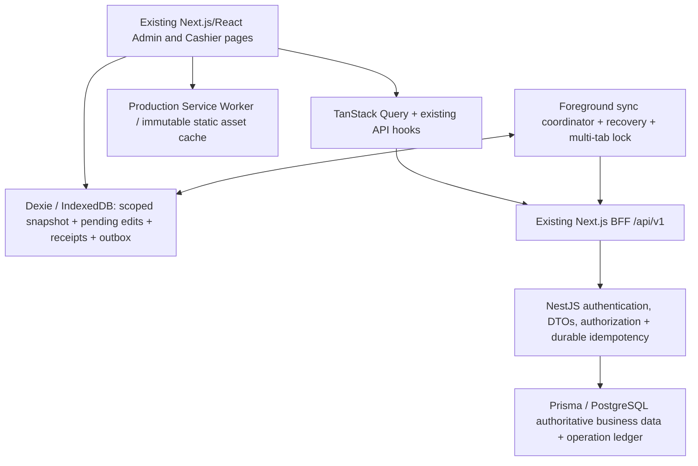

# SunTech POS — PWA and offline implementation plan

**21 November 2026 · Release status: ONLINE_ONLY · Phase 1 in progress**

Start with reliable recovery of an online sale when the register loses its connection. Installation, authorized offline reads, locally recorded sales and month-long operation have separate release gates. Keep the existing Admin and Cashier URLs, checkout controls and accounting rules throughout.

## 0. Execution order

**Start at increment 1B in section 7.** Phase 0 inspected both repositories. Increment 1A protected register evidence during session changes. Authorize one phase at a time and record the result against its exit criteria.

| Delivery | Dependencies | Scope and owner | Evidence before release |
|---|---|---|---|
| Phase 1 — online recovery | Existing online APIs | Frontend POS/API owners repair retry identity, acknowledgment handling and draft persistence. | Denied storage causes zero POSTs. Lost responses retain the original identity. Staging sale/refund works. |
| Phases 2–3 — shell and storage | Online baseline; D01 and D11 for device/origin qualification | Frontend builds a locked shell on existing URLs and migrates the working-tree Dexie DB. | Cold restart loads the shell; interrupted migration retains existing records. |
| Phases 4–5 — authorized reads | Shell/storage, D03–D04, capacity inputs from D09 | Backend adds device authority. Frontend consumes the existing branch bootstrap and publishes complete scoped snapshots. | Expired grants, partial snapshots and account changes deny access. A provisioned operator can reopen a complete branch catalog offline. |
| Phases 6–7 — sales pilot | Authorized reads, D06, historical shift rules from D08, compatible deployed backend | Frontend commits sale, receipt and outbox together. Backend/QA qualify the existing sale-sync contract on PostgreSQL. | Offline printing and concurrent/lost-ack replay produce a recoverable receipt and one committed financial effect. |
| Phases 8–10 — additional operations | Sale reconciliation; D05, D07 and D08 | Finance and domain owners qualify refunds, individual Admin commands and historical accounting. | Cross-till conflicts enter review. Finance signs off on daily totals, refunds, drawer attribution and advance deductions. |
| Phases 11–12 — month-scale qualification | Approved device volume, backup, retention and operating policies D09–D12 | Operations, QA and the deployment owner rehearse restore, update, rollback and a sustained outage. | Independent restore preserves original IDs; reconciled money and named devices/branches receive sign-off. |

Before any real-money pilot, appoint the recovery owner, approve the loss window, and demonstrate that stopping new intake still permits recovery of existing records. Decision owners and downstream gates are in the [decision register](offline/DECISIONS.md).

### Non-negotiable development discipline

- **Existing working code wins:** do not reimplement successful APIs, redesign pages, alter cards/variant chooser, or introduce new routes purely for an offline demo.
- **Small code changes:** prefer new tested `src/features/offline/...` repositories/services and minimal adapters in existing hooks/components. No unrelated cleanup.
- **No agent-only shortcuts:** TypeScript passes + unit tests are not enough. Production build, real browser offline/restart tests, backend idempotency tests, and actual receipt printing are required.
- **No blind patch application:** older generated Lesson 07/08 snippets, ZIP patches, previous audit findings and this README may be stale or incomplete.
- **No destructive storage cleanup:** never erase pending/unknown paid records as a migration strategy, on logout, during SW updates, or on a sync failure.
- **Safe Git workflow:** branch/commit per phase, preserve unrelated uncommitted work, do not silently reset/rebase/push/deploy, show diff/test summary.
- **Do not run unreviewed scripts from old archives:** prior audit reported potentially suspicious historical install/lint files; inspect first, especially `eslint.config.js`, historical `init` hooks, package scripts and dependencies.
- **Never include secrets** in source exports, logs, chat, fixtures or front-end storage. Review environment hygiene before any build/deploy.

---

## 1. Validated starting point

Frontend `codex/offline-phase-1-recovery` at `4a2b5dc`. Backend `main` at `cdcde71` plus local changes. The Dexie dependency, frontend category writer and catalog hook changes are present in the working tree. The backend working tree also includes order-service and Prisma changes, including the untracked sync-hash migration. Review and capture those intended changes before staging and verify the database migration state.

| Area | Present in current code | Remaining work |
|---|---|---|
| Session and drafts | Providers distinguish 401/403 from unavailable verification. Cleanup preserves register evidence. Held drafts require exact user, business and location. Redux waits for hydration before writing. | sessionStorage is tab-scoped. A failed write can still lose a hold or retry record. Legacy drafts without ownership need explicit reconciliation. |
| PWA startup | Next 16/Turbopack with PWA disabled. Providers unregister workers. The manifest points to /login and a missing /next.svg. Phase 0 observed zero registered workers and failed offline terminal restart. | Qualify a compatible worker, icons, safe update and a locked offline startup path. Keep personalized HTML, RSC and API responses out of public caches. |
| Local catalog | `src/features/offline/db/category-cache.ts` writes category snapshots per user/business/location to version 1 of `suntech-pos-offline-v1`. Terminal variant search requests pages of 30. | Add additive migrations and authorized reads. Neither a successful category write nor a page of variants establishes readiness. |
| Branch bootstrap | GET /api/v1/offline/bootstrap uses OfflineContextQueryDto, JWT and role guards. Admin selects an owned business and branch. Cashier uses token assignments. OfflineService returns active nested catalog and branch stock under RepeatableRead. | Reuse this complete snapshot for catalog reads. Add device authority, completeness metadata and atomic local replacement. Its response has no signed offline grant, order history or refund history. |
| Sale sync | POST /api/v1/orders/sync accepts SyncOrdersDto for Admin/Cashier. It requires deviceId and 1–100 sale items. Each has a v4 clientOrderId, original occurredAt, lines/prices and tendered amount. Order.clientOrderId is globally unique. Replay checks context and payload hash. | Wire the foreground outbox and prove crash/concurrent replay on real PostgreSQL. Verify the hash migration is deployed before enabling a client. |
| Other writes | Live refunds use POST /orders/:id/refunds. HTTP idempotency uses a 24-hour record; the interceptor stores success after handler completion. | The sale batch cannot carry refunds, expenses or payroll. Design and approve each additional offline operation separately. |
| Receipt and accounting | Current receipts use official order data. The print document requests an external Bengali font. Sync distinguishes occurredAt from server creation. | Add a distinct printable local pending reference, offline print assets and evidence of correct original Dhaka day/shift attribution. |

**Validation on this revision.** Frontend typecheck passed and Vitest passed 231 tests across 32 files. Backend Jest passed 400 tests across 34 suites. The earlier Phase 1 Chromium checks covered 401, 403, 503 and disconnection. The earlier production build passed on retry with a Next security warning; Phase 0 lint lacked a flat configuration. Build, lint, physical printing, authenticated staging sales and real PostgreSQL crash/concurrency tests were not rerun for this documentation review.

See the [Phase 0 evidence](offline/PHASE_0_EVIDENCE.md) for historical findings and the [backend contract matrix](offline/API_CONTRACT_MATRIX.md) for all 97 inspected handlers. Section 7 updates the status of findings affected by the subsequent recovery patch.

---

## 2. Business invariants — never silently change

1. **Keep all existing pages, URLs, layouts and flows.** Integrate with existing Direct Sale (Cashier and Admin), Custom Sale, Catalog, Orders/Refunds, Shifts, Expenses and relevant Admin pages through existing hooks/components. No new user-facing “offline lab,” dashboard, or checkout page. Small status indicators within existing UI are allowed if necessary and consistent with design.
2. Both **Admin and Cashier** need meaningful offline support in approved scopes. Super Admin must not be forced to select a branch for unrelated online actions; sensitive Super Admin actions default to online-only until designed/approved.
3. Cashier checkout works **without an active shift** (`shiftId` optional/null). **Never make a shift mandatory**.
4. Negative stock is **permitted** by existing business policy. Offline stock is a last-known snapshot, not a hard reservation.
5. Product creation requires **at least one variant**. Every catalog sale references the **real variant ID** and preserves existing compact card/variant UX.
6. Payment methods are **`COD` (cash), `BKASH`, `NAGAD`, `BANK`** as actual backend-facing enums. Cashier confirms them manually; **do not add bKash/Nagad/card gateway verification**.
7. Amounts are whole-number **BDT**. Business dates, shift/day reporting use `Asia/Dhaka`. Preserve explicit original occurrence time, distinct from server-created/accepted time. Invalid timestamps must not silently become “today.”
8. Existing **Advance Ledger** and payroll/net-paid accounting must stay unchanged; do not double-deduct advances or invent gross payout/expense entries.
9. Opening cash `null` (“not counted”) is not `0` (“counted zero”). Preserve all existing shift cash semantics.
10. Authorized offline users must see local cached categories/products/variants, relevant branch/shift/order history, and can print **local pending** receipts immediately after a **committed** local transaction; only server-confirmed receipts show server invoice IDs.
11. A timeout or 5xx is **not proof that a financial operation failed**. Retain immutable intent, original id, actor and payment evidence; never replace/recreate it silently.
12. No barcode scanner SDK, hardware printer SDK, Redis, new microservice, n8n automation, database sharding or CQRS by default. Prefer existing modular NestJS + PostgreSQL + Next.js deployment. n8n is **not** the PWA/sync engine.
13. Preserve normal online APIs and UX when offline features are disabled. All new financial offline behaviors must be feature-gated and backwards-compatible.

---

## 3. What “works for 30 days offline” means (and its limits)

### Acceptance definition

An **already registered/provisioned and approved device** that was recently online can, for a business-approved duration covering a **full 30 days without connectivity**:

- launch the existing PWA URLs after browser close/reopen or device reboot, without relying on a live Next.js/NestJS request;
- unlock an authorized offline user/branch, display complete approved cached data and supported Admin/Cashier screens;
- create permitted sale/refund/Admin operations locally; after each successful **atomic local commit**, show local pending status, printable receipt and unique local reference;
- retain all unresolved records across refresh, restart, app deployment/update and normal device sleep;
- on return to network, reauthenticate, verify server reachability and scope, reconcile/retry **same operation IDs**, receive backend confirmations, preserve conflicts for human review, and eventually update reports correctly;
- survive routine intermittent outages/retries with no duplicate committed sales, refunds, stock movements or financial expenses.

### Explicit limits requiring business agreement

- Browser data can be deleted by user action, OS/device failure, browser reset, storage eviction/quota, private mode, malware or disk loss. `navigator.storage.persist()` can improve retention but **is not an external backup**. Determine encrypted export/restore policy and acceptable loss window.
- A disconnected device cannot know immediate remote user revocation, branch suspension, changed prices, other tills' sales/refunds, or new policies. Offline authority is **time-bounded delegated trust**, not perfect live authentication.
- Background sync and service workers are **not continuously running** and vary by browser. **Foreground sync** on reopen/focus/reconnect/manual action is mandatory. Do not promise automatic sync while browser closed.
- A 30-day test cannot be proven solely by changing `Date.now()` in unit tests; combine accelerated-clock scenarios with real device endurance/pilot and restore tests.
- If policy forbids 30-day offline permission or independent backups, record the limitation and do not advertise that guarantee.

**Do not silently weaken security to meet the “30 days” marketing claim.** Escalate any impossible requirement/trade-off for explicit approval.

---

## 4. Proposed architecture (validate against real code)



### Read behavior

- **Online:** first reuse valid TanStack Query memory data; otherwise request the existing authenticated API; update scoped Dexie from verified complete responses; keep the same UI behavior.
- **Offline / backend unavailable:** if a **verified offline grant** + complete local snapshot + correct actor/branch scope exist, read Dexie quickly, without waiting for a full 15-second Axios timeout on each action.
- **401/403 or confirmed revocation:** do not silently bypass authorization using cached browser profile data. Distinguish network failure from actual auth rejection.
- **Partially cached catalog, missing data or corrupted DB:** show offline-not-ready state on the existing screen; **never silently claim full stock/catalog or accept paid checkout**.
- Cache replacements are **per scope** and atomic; do not overwrite pending Admin edits during a server pull.

### Write behavior

- **Both when online and offline (after financial gate):** validate and freeze immutable intent, generate one stable UUID, commit `localSale/refund + receipt + outbox` in **one IndexedDB transaction**, then show “Locally recorded” and optionally attempt immediate network sync. Keep existing server-confirmed UX if the server responds normally.
- Server acknowledgment is a separate transition. A local receipt is **not** a server-confirmed invoice. No external request inside Dexie transaction.
- Every queued operation is replayed with the **same ID + same immutable payload + same original actor/scope/time**.
- Reads/pulls must never delete pending records or hide unresolved paid operations.

---

## 5. Exact route and code ownership map (existing observed, verify live)

| Existing screen/behavior | Observed path / code ownership | New implementation belongs |
|---|---|---|
| Cashier catalog sale | `/pos/terminal` → `src/app/(dashboard)/pos/terminal/page.tsx` → `src/features/pos/components/terminal-workspace.tsx` | Underlying catalog hooks, local checkout service, offline state/status component; **no new page** |
| Admin direct sale | `/admin/terminal` → analogous page, same `TerminalWorkspace` | Same shared services with authorized Admin scope |
| Custom sale | `/pos/custom-sale`, `/admin/custom-sale` → `custom-sale-view.tsx` | Shared immutable local checkout and receipt adapter |
| Cashier orders/refunds | `/pos/orders` → `orders-workspace.tsx` | Order history local read, offline refund service |
| Admin orders | `/admin/orders` | Same scoped read/reconciliation pipeline |
| Admin catalog | `/admin/catalog` → `src/features/catalog/components/catalog-manager.tsx` | Catalog read repository, approved Admin pending-edit overlay |
| Shifts | `/pos/shifts`, existing Admin shift views | Cache original shift intent; advanced open/close protocol later |
| Admin expenses, HR | `/admin/expenses`, `/admin/payroll`, existing staff/advance modules | Domain-specific approved offline operations only |
| HTTP client | `src/lib/api-client.ts` (`/api/v1`) | Auth/reachability classification, no blind POST retries |
| BFF forwarding | `src/app/api/v1/[...path]/route.ts` | Preserve cookie/tenant/header semantics, fix verified response defects |
| Session | `/api/session` and Nest `/api/v1/auth/*` | Separate offline authorization, not cached cookie pretending to be live |
| Categories/products/variants | `src/features/catalog/api/use-catalog.ts`; `/api/v1/catalog/{categories,products,variants}` | Existing hook adapters and complete snapshot repository |
| Live sale/refund | `/api/v1/orders/catalog`, `/api/v1/orders/custom`, `/api/v1/orders/:id/refunds` | Preserve current online; new versioned sync contract **only if needed** |
| Batch sale sync | Nest OrdersController.syncOrders → OrdersService.syncOrders → Prisma Order | Foreground replay adapter in Phase 7; preserve clientOrderId across attempts |

Use the [contract matrix](offline/API_CONTRACT_MATRIX.md) for controller guards, DTOs, replay rules and backend source locations.

---

## 6. Required offline data and contracts (PROPOSAL, not an existing schema)

### 6.1 One browser database, with versioned migrations

Suggested module organization (adapt if current repo already contains equivalent code):

```text
src/features/offline/
  db/
    offline-db.ts                  # ONE Dexie instance + additive migrations
    repositories/catalog.ts
    repositories/operations.ts
    repositories/receipts.ts
    repositories/provisioning.ts
  auth/offline-capability.ts
  services/bootstrap.ts
  services/catalog-download.ts
  services/connectivity.ts
  services/local-checkout.ts
  services/local-refund.ts
  services/sync-coordinator.ts
  services/reconciliation.ts
  services/backup-restore.ts
  components/offline-status.tsx   # embed in EXISTING screens only
  types.ts
```

No new `src/app/**/page.tsx` for teaching/demo. Do not ship `/dexie-lab`, `/dexie-transaction-lab` or `/offline-catalog-lab`. Before deleting old lab service workers, unregister **only their scope** and delete **only their named caches**. Never clear all browser site data.

### 6.2 IndexedDB stores

| Store | Proposed stable key and purpose |
|---|---|
| `deviceProvisioning` | deviceId, scope, issued/expiry, verified capability/key versions and provisioning state. |
| `catalogMetadata` | `[userId,businessId,locationId]` → snapshot/version/time, counts, completeness/verified scope. |
| `categories`, `products`, `variants`, `stockSnapshots` | Composite scope + domain ID, server version, deletion/tombstone metadata; full authorized data. |
| `shiftSnapshots` | Original shiftId/status/openedAt/actor and branch; `shiftId` may be null for checkout. |
| `orderHistorySnapshots`, `refundHistorySnapshots` | Authorized line-level order/refund information needed for offline refund checks, version/date. |
| `pendingAdminEdits` | Immutable operation/base server version/optimistic overlay (never clobber confirmed snapshot). |
| `localSales`, `localRefunds` | Immutable local financial facts, original occurredAt, scope, status, official server mapping when known. |
| `receipts` | Printable immutable local snapshot, local reference, printed/reprint state, optional server invoice added on ack. |
| `outbox` | Stable UUID, device/actor/scope, type, immutable payload, fingerprint, dependencies, retry state/error/result. |
| `syncMetadata` | Cursor, last successful pull/push, version/protocol support, queue status and last error. |
| `backupMetadata` | Export/checksum/history, never mark backup complete before validated external write. |

Use composite or namespaced keys so **one user's or branch's data cannot be accidentally displayed to another**. IndexedDB storage is origin-scoped, **not user-private by default**. Client filtering is not security authorization.

### 6.3 Outbox envelope (illustrative only)

```ts
export type OfflineOperationStatus =
  | "PENDING" | "SENDING" | "UNKNOWN" | "RETRY_WAIT"
  | "SYNCED" | "NEEDS_REVIEW";

export interface OfflineOperation {
  operationId: string;            // crypto.randomUUID(), generated once
  deviceId: string;
  actorId: string;
  businessId: string;
  locationId: string;
  type: "SALE" | "REFUND" | "CATEGORY_CREATE" | "PRODUCT_CREATE"
      | "PRODUCT_UPDATE" | "VARIANT_CREATE" | "VARIANT_UPDATE"
      | "STOCK_ADJUSTMENT" | "EXPENSE_CREATE" | "ADVANCE_CREATE";
  payloadVersion: number;
  payload: unknown;               // immutable original data; backend validates exact DTO
  payloadDigest?: string;         // if computed, canonical digest must be compatible with server
  dependsOn: string[];
  occurredAt: string;             // offset-aware, original event time
  createdLocallyAt: string;
  status: OfflineOperationStatus;
  attemptCount: number;
  lastError?: { code: string; message: string };
  nextRetryAt?: string;
  serverResult?: unknown;
}
```

This is a **design sketch**. Codex must define real narrowed discriminated unions per verified backend business operation and schema version; do not paste the sketch into a production DTO blindly. Do not use the existing short `computePayloadHash()` as a cryptographic proof of financial payload equality.

### 6.4 Sync lifecycle

```text
Create/validate immutable intent
  └─(one local transaction commits sale + receipt + outbox)─> PENDING
PENDING ──claim with lease──> SENDING
SENDING ──verified authoritative ACK──> SYNCED
SENDING ──timeout/connection loss/process crash──> UNKNOWN
SENDING ──transient retryable 5xx/429──> RETRY_WAIT (same ID/payload)
UNKNOWN ──authenticated lookup or idempotent same-ID replay──> SYNCED / RETRY_WAIT / NEEDS_REVIEW
RETRY_WAIT ──backoff expires──> SENDING
Any irreconcilable scope/validation/conflict ──> NEEDS_REVIEW (retain record)
```

- The network does **not** promise exactly-once delivery. Aim for **at-least-once send attempts, at-most-once committed business effect**, proven by a database uniqueness/transaction design.
- Persist the state change before starting a send; old `SENDING` after crash becomes `UNKNOWN` once its lease expires; do not drop.
- A normal `401` pauses sync/re-authenticates; `403` needs permission/reconciliation handling. Do not wipe evidence.
- Do not generate a new operation ID because a request timed out. Intentional separate identical transactions must still have distinct IDs.
- A single in-flight queue owner per browser origin/device is preferable (Web Locks where supported + recoverable lease), **but backend unique constraints remain mandatory**, including across tabs/devices.
- Refund depends on original sale acceptance if original sale was offline. Queue ordering must respect dependencies while not permanently blocking independent later operations.

### 6.5 Required backend sync invariants

Use SyncOrdersDto and the existing per-item sale result. Document compatible extensions for capabilities that remain missing.

1. For sales, reuse the globally unique clientOrderId and verify its actor, device, business and branch on replay. Define durable scoped identity for each additional operation type. Verify proper tenant/object ownership for every operation. The browser does not get to authorize itself by claiming a role/scope.
2. Atomic database transaction records **operation identity + immutable payload digest/result + order/refund/stock/cash accounting side effects**. Avoid writing the idempotency record only *after* committing a sale.
3. Exact repeated ID + same canonical payload returns original committed result; same ID + different payload is a conflict; concurrent duplicates commit **one** effect.
4. If DB commit succeeds but HTTP acknowledgment is lost, lookup/replay returns the original result and original official record ID.
5. Server can accept/reject a **multi-day-old** original event without silently replacing its original actor, price, time, scope, payment or shift intent. Define stale-price/archived-variant/revoked-user review policy.
6. Refund validation checks cumulative refundable quantities transactionally across all devices and all earlier refunds; physical payout evidence is retained even when server requires manual review.
7. Expose an **authorized stable-ID status/reconciliation capability**. Evaluate same-ID sale replay first; add a lookup contract only where authorized reconciliation still requires it.
8. Keep ledger and operation identity long enough to cover the approved retention/backup/restore horizon. A short Redis TTL is not sufficient for month-delayed financial replay.
9. Returns must distinguish `accepted`, `already_committed`, `rejected_no_effect`, `unknown/review` with machine-readable reasons, and server ID mapping. The sale wire contract already returns ACCEPTED, DUPLICATE or REJECTED per item. Record the official ID for acceptance or matching duplicate. Retain evidence on generic rejection, missing results or uncertain transport.
10. Operations from old client versions must be explicitly supported or rejected non-destructively; never silently reinterpret older payloads.

---

## 7. Phase-by-phase build plan — run ONE phase per Codex iteration

### Phase 0 — Baseline complete

The evidence and decision register were committed at `df16451`. Recheck source and deployment drift before each implementation gate.

### Phase 1 — Online recovery in bounded increments

| Increment | Changes and boundaries | Acceptance tests |
|---|---|---|
| 1A · implemented | `4a2b5dc` covers session verification, logout cleanup, draft hydration, ownership and per-scope counts. This addresses the recovery portions of ST-F07–09 and F16. | Retain the session-recovery regression tests. Rejected or unavailable sessions cannot open protected screens; the original operator retains recovery evidence. |
| **1B · next** | ST-F01–03. Fix persistence outcomes in `src/lib/financial-operation.ts` and submit locks in terminal-workspace, custom-sale-view and orders-workspace. Review shared consumers, including payroll-manager. Keep the online API, manual tenders, optional shift and current UI. | Denied storage getter, quota or unreadable prior record: retain input and send zero POSTs. Exact retry reuses the original key and frozen payload. A different payload cannot replace pending/unknown work. Validation releases the lock; double-click sends once. |
| 1C · acknowledgment and reconciliation | ST-F04–06, F11 and F13. Separate server acknowledgment from receipt generation. Freeze submitted inputs. Classify refund conflicts by verified server semantics and retain expense identity after uncertain outcomes. | Inject lost acknowledgment, receipt-mapping failure and distinct 409 causes. None may trigger a fresh sale/refund POST. Manual review retains attributable evidence. |
| 1D · held sales and proxy | Remaining ST-F09–10 and F12. Make draft persistence observable before clearing a cart. Guard resume over occupied carts. Repair bodyless upstream response handling in the existing BFF. | Quota and conflicting holds retain cart contents. Resume needs a deliberate choice. Test empty 204/205/304 and HEAD, multiple Set-Cookie headers, and logout confirmation. |
| 1E · reporting and release hygiene | ST-F14–15 and F17–19. Align dates, export filters, refresh timestamps and invalidation. Ignore/init fixes already landed. Deployment owner checks credentials and the framework advisory; frontend restores trusted lint configuration. | Invalid dates cannot silently become today or widen history. View and export agree. Record security disposition, lint result and authenticated staging smoke results. |

**First patch procedure.** Add failing tests at the real storage and mutation boundary before modifying the helper. Include legacy pending records missing a snapshot, denial of read/write access, restart of the same tab and a later intentional identical sale after the first has been confirmed. Keep an old unresolved intent recoverable even if the new form fails validation. Do not enable queued payments in this increment.

**Phase 1 exit.** Complete the affected handler regressions, full tests, typecheck and production build. Run authenticated sale/refund smoke on a disposable staging tenant. Record the diff and rollback for each patch. A rollback must preserve stored identities and unresolved evidence.

### Phase 2 — Production PWA shell on EXISTING pages (no financial offline)

**Target:** Installable app; existing `/pos/terminal` and `/admin/terminal` can reopen after offline browser restart, with a safe offline shell and truthful not-ready state.

**Implementation:**

- Choose a **maintained, actually compatible** service worker build method for the installed Next 16 build (verify tooling/webpack vs Turbopack). Prefer minimal audited worker and strict cache rules over blindly enabling broad plugin caching.
- Replace intentionally disabled PWA config only after worker design passes; remove/restrict existing blanket SW unregister code in `src/app/providers.tsx` safely. Migrate/unregister only old owned workers and named caches.
- Repair manifest metadata/icons (correct URLs, size/type/maskability, suitable `start_url` that respects current role/login). HTTPS/localhost; ensure installed site has a stable origin.
- Explicitly support offline navigation on **existing URLs**. Next App Router has layouts/RSC/RSC payloads; a cached static `offline.html` that merely displays a blank placeholder is NOT proof the existing POS works. Inspect server requirements/middleware and implement a neutral safe app-shell startup with existing UI components. No public caching of authenticated SSR responses, session/tenant HTML, arbitrary RSC payloads, or private API responses.
- Precache build-correct static JS/CSS/fonts/icons and existing receipt print dependencies; verify asset integrity across update/rollback, including 30-day-old installs. Do not pre-cache personalized HTML or business data in Cache Storage.
- Exclude `/api/**`, auth/session endpoints, mutating requests, cookies, private images/order data from service-worker HTTP cache unless later explicitly and narrowly designed. No fake “online” based on `navigator.onLine` or `/api/warmup`.
- Don't auto-activate a breaking worker while pending paid work is open; maintain compatibility or defer activation according to tested version plan.

**Tests:** install PWA on real target browsers, close/reopen and hard reload each existing target route while network **actually disconnected** (not only Chrome Offline checkbox); check no private response leak when another user signs in; test SW update and safe cache cleanup. Verify normal online navigation, logout, printing and BFF routing unchanged.

**Exit gate:** existing UI shell can load offline and recognizes *not provisioned / not authorized* status; **no payment functionality enabled**. Could deploy this narrow safe increment if staging/pilot checks pass.

### Phase 3 — One production Dexie DB, migrations, storage health and resilience

**Target:** Verified local persistence without changing existing paid flows.

**Implementation:**

- Deduplicate all experimental/new category-cache DB instances. Use **one production Dexie DB**, deterministic additive versions and keyed user/branch scope. Inspect/upgrade current live schemas before editing.
- Implement typed stores/repositories for proposed records; explicit migration handling for older clients, backup before destructive schema changes, rollback strategy.
- Test storage availability/quota and `navigator.storage.estimate()/persist()`; show explicit not-ready on denied/quota/transaction abort. Never pretend `put()` request success means commit; await the overall transaction.
- Add durable `deviceId` (treated as identifier, not proof of secure hardware identity), migrations and safe per-user/branch partition. Keep sensitive fields minimal. Clear active UI state on account switch, not unresolved paid records.
- Add load-test fixtures for catalog and 30-day transaction volumes; do not store images as huge Base64 blobs without size budgeting.

**Tests:** create/read/update/delete, multi-store transaction rollback, refresh/restart, two tabs, quota, partial migration failure, cross-tenant isolation, clear-site-data detection and storage denied/private mode.

**Exit gate:** safe read/write repositories and migration tests, but **no offline business write enabled**.

### Phase 4 — Backend snapshot/version contract + offline provisioning/authorization

**Target:** An authorized device can prove it has a complete branch snapshot and limited offline authority, without treating a 7-day UI cookie as 30-day permission.

**Backend work (inspect DTOs first):**

- Reuse OfflineService.bootstrap’s consistent full catalog snapshot. Define version/completeness checks and full replacement semantics. Add a cursor and tombstones only if incremental refresh is needed. Avoid assuming a series of page=1..N GETs is one consistent snapshot under concurrent edits.
- Scope snapshot to current active user/business/location; include permitted order/refund history and shift context as needed; record payload version, `snapshotId`/cursor, counts/checksums and completion marker. If no native version API exists, implement an explicit compatible contract, not an invented frontend-only field.
- Define online device provisioning and **asymmetrically signed** offline capability (server private key, client-verifiable public key; no signing secret in browser). Bind verified actor/device/scope, permissions, issue/expiry/keyVersion/revocation epoch. Define a 30-day-capable policy **only after business/security approval**.
- Design local user unlock/PIN or equivalent for shared devices, clock-tamper behavior, offline logout and user switching; offline permission must be checked before any protected local business view/write. On reconnect Nest validates live actor/scope again.

**Frontend:**

- Download **complete verified scope** before marking ready; replace confirmed snapshot atomically; use scoped data adapter through existing hooks; preserve TanStack memory cache and existing API as online source. No separate Catalog/POS page.
- Build a real uncached authenticated BFF→Nest reachability check (new backend capability only if needed); current `/api/warmup` returns 204 even if Nest down and is not health proof.
- Active-device version checks at agreed **2–5 minute cadence while online**, plus immediate reconnect/focus/new mutation triggers; do not delay paid outbox recovery for polling interval.
- Pending Admin edits are an overlay, never overwritten by refreshed confirmed data.

**Tests:** first-time offline not ready; correct/expired/mismatched offline capability; admin business A→B, cashier branch isolation, partial 30th page, deletion/tombstone, snapshot changes during pagination, suspended user on reconnect, replayed/corrupt signature, offline user switch, clock changed, 30-day validity boundary.

**Exit gate:** offline reads for approved routes/roles with explicitly verified grant and full snapshot. **No offline paid mutations yet.**

### Phase 5 — Existing-page local catalog + operational read fallback

**Target:** Existing screens remain useful during a network or NestJS outage without changing their UX.

**Implementation:**

- Adapt `useCategories`, `useProducts`, `useVariants`, `useInfiniteVariants` and relevant shift/orders reads through scoped data-source/repository adapters. Preserve existing hook return shapes, query keys, filters, `getNextPageParam`, product card props and API endpoints.
- When online, use fresh TanStack Query data then API, and persist fully verified snapshots. When offline, hydrate from authorized IndexedDB promptly; distinguish offline-read status from stale live server data.
- Make local search/filter/pagination semantically match backend behavior (including category-by-name filtering, variant IDs, archived records and full catalog coverage). Do not claim parity without fixture comparison.
- Show last successful sync/staleness in existing header/status UI. Distinguish `ONLINE`, `CHECKING`, `SERVER_UNAVAILABLE`, `OFFLINE_READY`, `OFFLINE_NOT_READY`, `SYNCING`, `NEEDS_REVIEW`, `AUTH_REQUIRED` as appropriate.
- Offline `401/403` must not become a local authorization bypass. Skip fallback for unavailable/expired/incorrect grant and incomplete snapshot.

**Tests:** same product display and checkout selectors online; offline search/filter across pages; branch switch; data refreshed after reconnect; backend down but Wi-Fi connected; logout/reauth; nil/zero products and deleted records; no cross-account leak.

**Exit gate:** complete read-only offline operation on existing pages, passing design/role isolation checks.

### Phase 6 — Durable **local sale** + printable receipt (gated until Phase 7 backend proof)

**Target:** Safely record permitted catalog/custom sales locally; never show “paid/saved” unless storage commit succeeded.

**Implementation:**

- Build one shared local-checkout service used by Cashier/Admin existing terminal and custom sale, with current validation, variantId, captured price/quantity, nullable shift, payment enum, original actor/branch, customer fields and Dhaka timestamp. Do not change card layout or create a new checkout page.
- Before locking final intent, verify offline grant, full local catalog, storage health, payment confirmation and user scope. Freeze immutable payload so edits, hold/resume, navigation or double-click cannot change an in-flight sale. No fake stock reservation.
- Generate **one stable UUID**, then **in one Dexie `readwrite` transaction** persist `localSale + printable receipt + outbox operation`; only after commit show “Locally recorded — Pending Sync” and allow print/reprint. On failure leave the cart and explicitly explain that sale was not saved.
- Local printable reference distinct from official server invoice; receipt rendering should work with cached fonts/CSS/images. Printing failure should never cause another sale POST.
- Maintain online UX: immediately attempt safe server commit after local commit, then show server-confirmed invoice on acknowledgment; original local receipt stays auditable.
- Work across days and restarts; don't block new independent sales solely because an earlier record is `UNKNOWN`, but never silently erase that earlier evidence.

**Tests:** atomic rollback, quota, crash halfway, double click, two tabs, custom vs catalog, optional shift, negative stock, manually confirmed payment methods, 00:00 Dhaka date boundary, receipt offline print/reprint, receipt renderer exception, storage write failure, restart with pending work.

**Exit gate:** all local invariants proven **in development and staging**; do **NOT** switch on real paid offline checkout until Phase 7 also passes.

### Phase 7 — Backend durable idempotency, submit/status/recovery, synchronization

**Target:** At-most-once committed financial effects despite retries, lost responses and month-late uploads.

**Implementation:**

- Analyze current `/orders/sync` and online order/refund services; prove/disprove current idempotency behavior with tests before changes. Create durable operation ledger/domain uniqueness and transaction boundary in Prisma/PostgreSQL (schema+migration+index) as necessary.
- Expose exact versioned create/sync + status/reconciliation responses only after backend contract review; do not reuse live POST with guessed payload fields. Keep online clients compatible.
- Include original business timestamp, actor/scope/shift intent, captured price/quantity, stable IDs, device and payload version; server validates all and determines acceptance/review according to approved business policy.
- Sync coordinator starts when app open/focused/reconnected/manual Sync Now; reauth first, genuine Nest availability check, per-origin/tab lock + lease, sequential first implementation, bounded backoff+jitter and separate per-record result persistence.
- On timeout mark `UNKNOWN` and lookup/retry same immutable ID. On 429 respect `Retry-After`; 5xx/backoff; 401 reauth; 403 review; 409 classify exact contract; 400 with no-effect response needs verified proof of noncommit; preserve all unresolved evidence.
- Reconcile accepted server IDs to local records atomically, update receipt metadata without falsifying original sale moment. No client-side “mark SYNCED” simulation in real application.
- Enable financial offline via flag only after full tests; backend must be deployed before frontend flag is enabled.

**Mandatory backend tests:**

1. First submit commits exactly one order/stock/cash effect.
2. Exact duplicate request concurrently (two connections) returns one result/effect.
3. Same ID/different payload rejects, preserves evidence.
4. Crash after DB commit but before HTTP response; retry/status lookup returns same official ID.
5. Crash before commit produces no partial domain effects and is retryable.
6. Real timeout/reconnect/expired login/revoked user handling.
7. 30-day-old request and original Dhaka accounting date/shift attribution.
8. Multi-tab and multi-device replay, 1,000+ backlog and ordered dependent operations.
9. 5xx/503 through Next BFF and bodyless responses do not cause duplicate sales.

**Exit gate:** signed-off financial tests in backend + frontend integration; first pilot only, feature flag controlled. **No 30-day production claim yet.**

### Phase 8 — Offline refunds and order-history dependencies

**Target:** Support approved partial/full offline refunds on original sales with transparent conflict handling.

**Implementation:**

- Cache authorized order lines/refundable quantities/refund history with version and bounded history policy. Original offline sale referenced by its **client ID**, with sync dependency before refund.
- Use a separate stable refund operation ID and immutable refund/pay-out evidence; preserve manual payment method as per current backend enum; never create a fake server orderId.
- Server performs transactional cumulative refundable-quantity checks across all devices; incompatible cross-device refunds are **NEEDS_REVIEW** rather than silently overwritten. Define how physically paid refund money is reconciled.
- Same local receipt/print and pending-versus-confirmed distinction; scoped permission/refund limits/approval policy.

**Tests:** full/partial refund, two devices refund same line, double retry, refund unsynced sale, original order archived, user revoked, wrong branch, cash already paid but server conflict, shift closed before sync.

**Exit gate:** backend refund idempotency + conflict/accounting verified; approve refund limits before enabling.

### Phase 9 — Admin offline catalog and selected financial writes

**Target:** Meaningful offline Admin operations without generic replay of every POST/PATCH.

**Implementation:**

- For each approved Admin command (category/product/variant create/update, price, stock, expense, Advance Ledger), inspect current DTO/permissions and design **domain-specific** durable operation and reconciliation policy.
- New local product/variant IDs need stable temporary IDs and dependency mapping; enforce product-with-at-least-one-variant invariant on sync. Server deletions/archives need tombstones and FK-aware conflict handling.
- Admin edits use `baseVersion` + optimistic overlay over confirmed snapshot; server compares versions, handles conflicts explicitly, does not silently last-write-wins.
- Stock adjustment: decide whether adjustment is `DELTA` or absolute `SET`; stale absolute overwrite of 30 days of concurrent sales is unsafe. Preserve negative stock policy.
- Expenses/Advances: preserve stable operation IDs, original attribution and existing Advance Ledger/payroll semantics; **no double expense or salary advance** after retry.
- Keep role changes, staff suspensions, login/password reset, forced logout, payroll disbursement and other sensitive irreversible actions **online-only** unless separately reviewed/approved.

**Tests:** Admin A offline edit vs Admin B online edit, stock conflict, archived variant still referenced by offline sale, local product+variant dependency, amount/price conflict, duplicate expense after lost response, Advance Ledger payroll calculation, tenant isolation.

**Exit gate:** separately approve and enable each supported Admin command, not a global “offline admin mode.”

### Phase 10 — Shift/date and long-outage accounting

**Target:** Preserve existing shift rules and correct late-arriving daily/monthly accounting.

**Implementation:**

- Every local sale retains original `shiftId` (which may be null) and original `occurredAt`; never attach a stale other user's or another day's shift.
- Define late-arrival accounting: if an old shift is closed when a sale syncs, preserve original intent and record supplementary reconciliation per agreed domain rules. Do not silently move it to sync date or reject physical cash evidence without review.
- Only add offline shift open/close if business explicitly approves a specialized dated event contract, including `null` vs 0 opening/closing cash and auto-close behavior. Do not merely replay live open/close requests 30 days late.
- Ensure local reports distinguish provisional local totals and server-confirmed totals, business day `Asia/Dhaka`, tender/refund amounts and Advance Ledger separately.

**Tests:** no shift, cross-midnight, multiple days offline, originally closed shift, invalid timestamp, counted 0 vs null, delayed refund, category price change, historical export parity.

**Exit gate:** accounting stakeholder approves examples; no silent historical rewrites.

### Phase 11 — Operational visibility, recovery, safe upgrades and backups

**Target:** Business can operate/recover when offline and after server or device incidents.

**Implementation:**

- Integrate small status/pending counters and Sync Now into **existing UI**: pending, unknown, needs-review, last verified data, last successful sync, backup health; avoid new pages unless explicitly approved.
- Add structured redacted logs/metrics: device/scope/operation ID (no customer PII or secrets), queue length/age, retries, lag, rejected/review count, DB quota/storage pressure, snapshot version.
- Add encrypted export of unresolved outbox/receipts/local financial data to an **independent medium** with integrity/version/restore rehearsal; approve key custody and loss window. Restore with same stable IDs (backend dedup).
- Implement app upgrade/backwards compatibility: DB migrations, old outbox DTO versions, old precached static assets; prevent SW cache cleanup from breaking active version while pending data exists. Controlled activation and rollback.
- Fix browser print dependencies and offline images/fonts; verify actual targets, not just a print preview screenshot.

**Tests:** site data manually removed (correct recovery/no false claims), device replacement/restore, quota nearly full, worker update mid-checkout, frontend/backend version skew, disconnected for 30 days then restored, interrupted backup, multiple tabs.

**Exit gate:** verified restore and rollback plan; operational playbook prepared.

### Phase 12 — Staging, pilot, phased deployment and release gates

**Target:** Publish safely, without making unsupported claims or risking financial loss.

**Order:**

1. Security review + baseline fixes deployed first; verify normal online POS unaffected.
2. Compatible backend migrations + idempotent sync/status/authorization endpoints deployed behind disabled flags.
3. Frontend PWA shell + local catalog with financial offline disabled; test install, offline restart, stale snapshot and user-switch security.
4. Enable offline sales on **one authorized test device/branch** with staging-like money reconciliation, then an explicitly approved limited business pilot.
5. Add refunds and specific Admin mutations behind separate flags; monitor conflicts and backlog.
6. Expand by **approved browser/device and branch**, never assume Safari/Android/Windows behave identically.

**Release evidence and sign-off:**

- Security/credentials: checked; no secrets in bundle; no active suspicious scripts.
- Build: pinned lockfile, production build, lint, typecheck, unit/integration/e2e tests pass; list any skipped checks.
- Existing online routes/layouts/product cards/checkout/refunds/shifts/reports still work.
- Service worker install/start and safe update/unregister verified on **actual** target devices and stable production origin.
- Provisioned user can launch after restart with both next frontend and Nest backend unavailable.
- Local paid transaction has sale+receipt+outbox committed atomically before success UI; printing works offline.
- Backend same-ID replay and simultaneous duplicates proven one effect; ack lost after commit proven recoverable.
- 30-day offline window tested with simulated elapsed time + a representative sustained pilot; volume/space/backup/restore qualified.
- Reconnect sync, historical shift/report attribution, outbox conflict review and cross-account isolation signed off.
- Rollback can **stop accepting new offline work** without deleting existing outbox/evidence or stranding old clients.

**Publish labels:**

- `ONLINE_ONLY`: current release, no offline promises.
- `PWA_READ_ONLY_OFFLINE`: installs, loads existing shell and approved cached reads; financial operations remain online-only.
- `OFFLINE_SALES_PILOT`: gated pilot at approved branch/device; clear “local pending” labeling and operator training.
- `OFFLINE_30_DAY_APPROVED`: only after security, multi-device, month-scale operation, backup, refunds/admin scopes, and final business acceptance.

**Do not equate code merged or CI green with production certification.**

---

## 8. Required QA matrix — convert to automated fixtures and human checks

| Category | Scenarios that must be covered |
|---|---|
| Network | No Wi-Fi, Wi-Fi with no internet, BFF live/Nest down, DNS failure, slow wake, 15s timeout, intermittent outage, 429, 5xx/204/304 responses, reconnect/focus. |
| Bootstrap | First launch unprovisioned, offline after provisioning, offline hard refresh on existing `/pos/terminal` and `/admin/terminal`, browser restart/reboot, old service worker version, missing asset. |
| Auth | 7-day `suntech_session` expires during 30-day outage, offline capability expiry, suspended user after disconnect, PIN/local unlock, two users one browser, Admin branch switch, Cashier other-branch denial. |
| Data | Full catalog beyond 30 variants, new/deleted/archive items, price change during pagination, empty valid catalog, version mismatch, corrupted/partial snapshot, migrations across app updates. |
| Paid checkout | Duplicate clicks/tabs, original UUID retained, receipt missing, aborted IDB transaction, storage quota, crash on send, commit+lost response, device reboot, manual payment enum, optional shift, negative stock. |
| Sync | Multiple tabs, duplicate same-ID replay, same-ID different payload, server DB rollback, committed result lookup, 401/403 vs timeout, backoff, cursor gaps, 30-day backlog. |
| Refund | Refund own offline unsynced sale, partial refund, double refund across devices, paid refund later rejected, original actor and payment evidence retained. |
| Admin | Create product+variant, optimistic concurrent edits, stale price, absolute stock overwrite, expense replay, Advance Ledger double deduction prevention. |
| Time/reports | Dhaka midnight/year change, original `occurredAt` vs server `createdAt`, closed/optional shifts, counted zero vs null, provisional vs confirmed revenue/refund. |
| Storage | Persist declined, eviction, quota, browser clear-data, database schema upgrade abort, controlled SW update, encrypted export/restore with same stable operation ID. |
| UI/print | Existing pages/product cards unchanged, offline receipt print/reprint, cached fonts/images, truthful pending count, status freshness, labels not falsely server-confirmed. |
| Deployment | Vercel preview vs stable origin, HTTPS, compatible backend-first rollout, old frontend binary with newer API, rollback with queued old operations, build tool compatibility. |

Do not use live customer payment credentials or production financial writes for destructive failure testing. Use a staging backend and disposable test tenant/branch, then a supervised pilot.

---

## 9. Business decisions Codex must record instead of guessing

Mark each `APPROVED`, `PROPOSED`, or `BLOCKED`. Never treat the proposed default as approval.

| ID | Required decision | Why it matters / candidate direction |
|---|---|---|
| D01 | Supported production browsers/devices; number of tills per branch | Start with qualified managed Chromium desktop if acceptable; separately qualify other required devices. |
| D02 | Independent disconnected tills or local-network-shared real-time state | PWA per-device sync cannot communicate between fully isolated devices; LAN needs different architecture. |
| D03 | Exact offline authority lifetime/renewal/revocation/clock tamper | Cannot guarantee immediate revocation while offline; signed delegated permission and business acceptance required. |
| D04 | Shared user/device/login/PIN/offline user switch | Defines local unlock, data partition and access to unresolved records. |
| D05 | Which Admin mutations must work offline in first release | Approve one domain at a time; avoid blindly replaying all POST/PATCH. |
| D06 | Old offline price/archived variant acceptance and limits | Must preserve historical captured price; server acceptance/review policy required. |
| D07 | Offline refund amount/age/approval and cross-device eligibility | Global refundable state unavailable during outage; conflict policy required. |
| D08 | Shift open/close during 30 days and sales arriving after shift close | Cannot attribute old cash to a new shift silently. |
| D09 | Catalog variants/images, average sales/day, maximal monthly queue | Drives pagination, quota, restore and throughput testing. |
| D10 | Independent encrypted backup frequency, medium, key custody, restore owner | Determines disaster recovery and honest 30-day retention expectation. |
| D11 | Stable deployment origin, feature-flag owner, pilot branch/device | Browser storage tied to origin; rollout must be controlled. |
| D12 | Operation-ledger/outbox retention and human conflict resolution | Never expire unresolved paid evidence before full recovery horizon. |

If a decision is needed for a specific phase, Codex must ask a **focused, short question at that phase gate**, not all questions up front and not silently assume an answer.

---

## 10. Codex response format after EVERY phase

At the end of each iteration, return exactly these sections in concise language:

```text
PHASE [N] — [NAME]
Target achieved: Yes / No / Partial

Files changed:
  frontend: [exact paths]
  backend: [exact paths]
  migration: [exact filenames]
  docs/tests: [exact filenames]

Verified source contracts: [route + DTO + guard + tenant scope]
Behavior preserved: [what existing flows were regression-tested]
Tests RUN: [commands, passed, failed]
Tests NOT RUN: [reason, owner]
Proof of key safety invariants: [test names or reproduced outcome]
Open risks / decisions: [IDs, do not invent approval]
Rollback: [safe steps preserving pending data]
Next smallest phase: [one concise proposal]

STOP at this gate. Do not begin the next phase until authorized.
```

### Strict definition of “done”

- Implemented code exists at current repo revision; no speculative snippets presented as completed work.
- All affected modules have tests; at minimum typecheck, relevant unit/integration, Next production build and browser behavior for frontend phases, plus real DB transactional tests for financial backend phases.
- Frontend/backend contract version and migrations are compatible; request/response shapes verified on actual code.
- Existing UI/flows have not been rewritten. Any deviation is explained and explicitly approved.
- Stale issues and empty/missing backend evidence are classified, not waved away.
- Safe on-device rollback and pending-data preservation is demonstrated.

---

## 11. Suggested official references (verify current versions at implementation time)

- Next.js App Router PWA guide: https://nextjs.org/docs/app/guides/progressive-web-apps
- Next.js App Router architecture: https://nextjs.org/docs/app
- Dexie / IndexedDB documentation: https://dexie.org/docs
- Dexie transactions best practices: https://dexie.org/docs/Tutorial/Best-Practices
- MDN Service Workers: https://developer.mozilla.org/en-US/docs/Web/API/Service_Worker_API/Using_Service_Workers
- MDN PWA offline/background behavior: https://developer.mozilla.org/en-US/docs/Web/Progressive_web_apps/Guides/Offline_and_background_operation
- MDN browser storage quota/eviction/persistence: https://developer.mozilla.org/en-US/docs/Web/API/Storage_API/Storage_quotas_and_eviction_criteria
- MDN Background Sync support limits: https://developer.mozilla.org/en-US/docs/Web/API/Background_Synchronization_API

**Compatibility note:** Next.js documentation currently describes some third-party offline tooling that needs webpack. This frontend uses Next 16/Turbopack settings; choose actual compatible tool after testing a real production build, not from tutorial assumptions.

---

## 12. Final directive to Codex

**Build SunTech's offline system as an extension of the current working POS, not a replacement.** Keep existing pages/routes, domain rules, manual tender methods, optional shifts, negative stock, business dates and accounting. Treat the live NestJS/Prisma implementation as the authority for data/permission behavior; propose versioned contract changes where necessary. Never use a UI-only offline retry, browser localStorage user role, successful Service Worker installation, simulated “SYNCED” status, or a passing unit test as proof of financial safety. Work **phase by phase**, gate each release, leave complete evidence, and preserve every unresolved paid intent until authoritative reconciliation.
